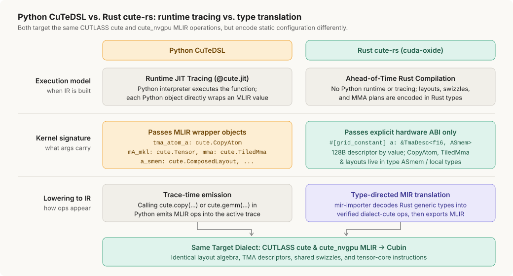
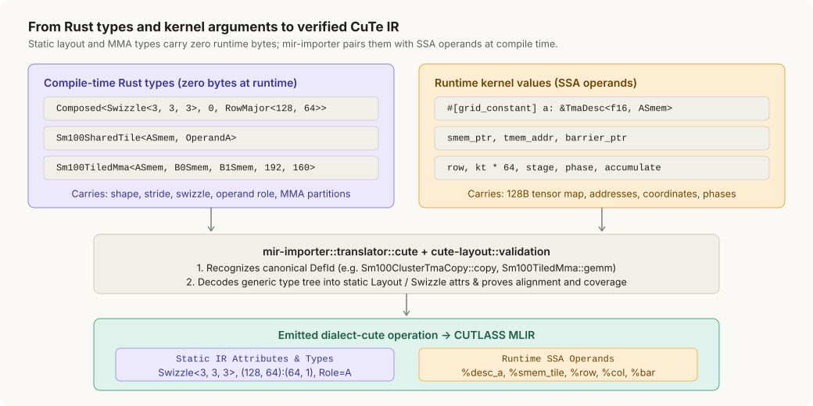

# CuTe-style GPU kernels in Rust (`cute-rs-preview`)

`cute-rs-preview` brings CuTe's layout algebra and tensor-core abstractions to **cuda-oxide** without a Python interpreter or runtime JIT tracer. Kernels express layouts, partitions, TMA transfers, pipelines, reductions, and MMA operations in **Rust's type system** (`cute-rs`), backed by typed instruction primitives (`ctm-rs`), and compile ahead of time through `dialect-cute` and the pinned CUTLASS 4.7 MLIR compiler.


- **`cute-rs` (top layer)** expresses tensor computation: `Tensor` / `TensorMut`, `zipped_divide`, `slice`, cooperative/tiled/TMA copies, producer/consumer pipelines, reductions, and tiled MMA.
- **`ctm-rs` (bottom layer)** provides instruction primitives independent of CuTe layouts: `#[kernel]` and launch contracts, thread/warp/cluster coordinates, `mbarrier` state machines, `tcgen05` / `TmemGuard` tensor memory, and packed register math over `cuda-device`. See [AGENTS.md](AGENTS.md) for the required boundary between the two layers.
- **`cute-layout` (shared algebra)** defines `IntTuple`, `Layout`, `Composed`, and `Swizzle`, and runs static proofs for cooperative copies, `ldmatrix`, and TMA swizzle alignment at both host and compile time.

---

## `cute-rs` vs. Python `CuTeDSL`

Both `cute-rs` and Python `CuTeDSL` lower to the **same CUTLASS `cute` and `cute_nvgpu` MLIR dialect operations**, but they get there in fundamentally different ways:



- **Python `CuTeDSL` traces live MLIR wrappers:** `@cute.jit` executes Python at runtime. Objects such as `cute.Tensor`, `cute.CopyAtom`, `cute.TiledMma`, and `cute.ComposedLayout` directly wrap MLIR values, so the host constructs them and passes all of them as `@cute.kernel` parameters.
- **Rust `cute-rs` translates static Rust types:** There is no runtime tracer. Kernel parameters carry only the **hardware launch ABI** (for example, a 128-byte `#[grid_constant] &TmaDesc<f16, ASmem>` passed by value), while layouts, swizzles, operand roles, and MMA configurations live in **Rust types** (`ASmem`, `Sm100TiledMma<...>`, `TmaLoadPipeline<...>`) that `mir-importer` decodes into `dialect-cute` operations at compile time.

```python
# Python CuTeDSL — kernel arguments wrap live MLIR types during @cute.jit tracing
@cute.kernel
def kernel(
    self,
    tma_atom_a: cute.CopyAtom,              mA_mkl: cute.Tensor,
    tma_atom_b: cute.CopyAtom,              mB_nkl: cute.Tensor,
    tma_atom_c: cute.CopyAtom,              mC_mnl: cute.Tensor,
    tiled_mma: cute.TiledMma,               cta_layout_mnk: cute.Layout,
    a_smem_layout: cute.ComposedLayout,     b_smem_layout: cute.ComposedLayout,
    epi_smem_layout: cute.ComposedLayout,   tile_sched_params: PersistentTileSchedulerParams,
): ...
```

```rust
// Rust cute-rs — static config lives in types; arguments carry only runtime TMA descriptors
type ASmem = Composed<Swizzle<3, 3, 3>, 0, RowMajor<128, 64>>;
type B0Smem = Composed<Swizzle<3, 3, 3>, 0, RowMajor<96, 64>>;
type B1Smem = Composed<Swizzle<3, 3, 3>, 0, RowMajor<80, 64>>;
type CSmem = Composed<Swizzle<2, 3, 3>, 0, RowMajor<128, 32>>;
type TiledMma = Sm100TiledMma<ASmem, B0Smem, B1Smem, 192, 160>;
type MainloopPipeline = Sm100TmaMmaPipeline<5, 77_824>;

#[kernel]
pub fn fp16_gemm_256x352(
    #[grid_constant] a: &TmaDesc<f16, ASmem>,
    #[grid_constant] b0: &TmaDesc<f16, B0Smem>,
    #[grid_constant] b1: &TmaDesc<f16, B1Smem>,
    #[grid_constant] c: &TmaDesc<f16, CSmem>,
    bias: *const f16, m: u64, n: u64, k: u64, has_bias: u64,
) { ... }
```

---

## How Rust types become CuTe IR

During device compilation, `mir-importer` intercepts `cute-rs` calls by their canonical `DefId`, decodes their generic type parameters (`static_config.rs`), and pairs those static layout attributes with the call's runtime SSA operands. Whole-module verification checks tensor provenance, pipeline state, and layout/collector contracts before lowering; dynamic phases, lane participation, and pointer lifetimes remain caller obligations.



### 1 · Tiling and slicing a 1D tensor ([`elementwise_cute`](examples/elementwise_cute))

`zipped_divide::<TILE>()` splits a flat vector into `(value_in_tile, tile_index)`. Each thread slices its own tile; full tiles emit a vectorized `cute.copy`, while the ragged tail uses an ordinary Rust loop:

```rust
let tid = thread::index_1d().get();
let t_a = cute_rs::Tensor::from_slice(a).zipped_divide::<4>().slice(tid);
let t_b = cute_rs::Tensor::from_slice(b).zipped_divide::<4>().slice(tid);
let mut t_c = cute_rs::TensorMut::from_disjoint_slice(&mut c).zipped_divide::<4>().slice(tid);

if t_a.is_full() {
    unsafe { t_c.store(t_a.load() + t_b.load()) };
} else {
    let mut k = t_a.base();
    while k < a.len() {
        unsafe { t_c.store_linear(k, a[k] + b[k]) };
        k += 1;
    }
}
```

### 2 · Typed TMA + block-scaled MMA ([`blockscale_gemm_cute`](examples/blockscale_gemm_cute))

Host tensor-map encoding and device TMA/MMA operations share the same layout types (`ByteSmem`, `SmemP`) and operand roles (`Mkl`, `Nkl`):

```rust
type TileP    = L<T2<C<128>, C<32>>, T2<C<32>, C<1>>>;
type SmemP    = Composed<Swizzle<2, 3, 3>, 0, TileP>;
type ByteSmem = Composed<Swizzle<2, 4, 3>, 0, RowMajor<128, 64>>;
type SharedA  = SharedTensor<Mxf4E2M1, f16, SmemP, Mkl>;
type SharedB  = SharedTensor<Mxf4E2M1, f16, SmemP, Nkl>;

// Compute warps wait on the TMA ring, load swizzled fragments + scales, and accumulate:
let scale_tile  = tiled_mma.load_scale_atom_128(&s_sfa, &s_sfb, wm, wn);
let scales      = scale_tile.pairs_at_unchecked(kk);
let a_fragments = tiled_mma.load_a_128(&s_a, wm, kk);
let b_fragments = tiled_mma.get_b_tile_k64(&s_b, wn, kk);
accumulators.accumulate_k64(&tiled_mma, a_fragments, b_fragments, scales);
```

### 3 · Combining `cute-rs` and `ctm-rs` ([`fp16_gemm_256x352_cute`](examples/fp16_gemm_256x352_cute))

Warp-specialized kernels combine `cute-rs` for layout-checked TMA, pipelines, and MMA (`dialect-cute`) with `ctm-rs` for cluster coordinates, barriers, and TMEM ownership (`dialect-nvvm`) in one Pliron module:

```rust
// Producer warp: cluster TMA load through cute-rs
let barrier = pipeline.producer_acquire_and_expect_tx(stage as u32, phase);
Sm100ClusterTmaCopy::copy(a, &mut a_tile, row, kt * 64, barrier, rank);

// MMA warp (rank 0): two-CTA paired MMA reusing the A collector
pipeline.consumer_wait(stage as u32, phase);
if warp::is_elected_sync(u32::MAX) {
    mma.gemm(tmem, &a_tile, &b0_tile, &b1_tile, accumulate);
    pipeline.consumer_release(stage as u32);
}
```

---

## What lives here

Focused kernel demonstrations live in `examples/`. Complete model workloads live in `models/`, with their reference scripts, fixtures, and benchmarks alongside the implementation. Both are discovered by `cargo oxide list` and run by name with `cargo oxide run`.

| Crate | Role |
| --- | --- |
| [`cute-layout`](cute-layout/README.md) | Tuple/layout foundations, parsing, algebra families, and validation shared by the Rust API and compiler. |
| [`cute-rs`](cute-rs/README.md) | Device-facing `tensor/`, `copy/`, `mma/`, `attention/`, and `epilogue/` domains, plus pipelines and foundational types. |
| [`ctm-rs`](ctm-rs/README.md) | Typed instruction families, independent of CuTe layouts, over `cuda-device`. |
| [`dialect-cute`](dialect-cute/README.md) | Operation families under `ops/`, with separate attributes, types, and whole-module verification in Pliron. |

| Example (progressive) | What it demonstrates |
| --- | --- |
| [`elementwise_cute`](examples/elementwise_cute) | Adds two vectors (`f32` and `f16`) through per-thread `Tensor` tiles and a scalar tail. |
| [`swiglu_cute`](examples/swiglu_cute) | Fuses SiLU and multiplication through typed register transforms, FP32 math, FP16 output, and scalar tails on SM120a. |
| [`rmsnorm_cute`](examples/rmsnorm_cute) | FP32/BF16 RMSNorm with full-warp reductions, explicit BF16 rounding, checked shapes, and vector-copy tails on SM120a. |
| [`ffn_cute`](examples/ffn_cute) | BF16 tensor-core gate/up/down projections with typed weight roles, checked strides, and explicit SiLU rounding on SM120a. |
| [`rope_cache_cute`](examples/rope_cache_cute) | BF16 RoPE, owned KV cache, and 128-wide GQA validating causal offsets and prefill vs. decode on SM120a. |
| [`nvfp4_gemv_cute`](examples/nvfp4_gemv_cute) | Multiplies a packed FP4 matrix by a packed FP4 vector with block scales on SM120a. |
| [`blockscale_gemm_cute`](examples/blockscale_gemm_cute) | Multiplies two block-scaled MXFP4 matrices with 3-stage TMA pipelines and tensor cores on SM120a. |
| [`blockscale_gemm_ctm`](examples/blockscale_gemm_ctm) | The same SM120a GEMM written directly against `ctm-rs` instruction primitives ([shared references](examples/blockscale_gemm_cute/reference)). |
| [`fp16_gemm_256x352_cute`](examples/fp16_gemm_256x352_cute) | SM100a two-CTA GEMM with typed shared tiles, TMEM, A-collector reuse, and cluster TMA pipelines. |
| [`fp16_gemm_256x352_ctm`](examples/fp16_gemm_256x352_ctm) | The same SM100a FP16 GEMM written directly against `ctm-rs` instruction primitives. |

| Attention & End-to-End Models | Target & Scope |
| --- | --- |
| [`qwen_decoder_cute`](models/qwen_decoder_cute) ([visual guide](models/qwen_decoder_cute/visual.md)) | **SM120a:** End-to-end Qwen3-TTS CustomVoice inference, validation, and waveform benchmarks. |
| [`sm100_fmha_prefill_cute`](examples/sm100_fmha_prefill_cute) | **SM100a/B200:** FP16 D128 prefill (dense or causal MHA/GQA) with FP32 accumulation and warp specialization. |
| [`sm100_mla_decode_fp16_cute`](examples/sm100_mla_decode_fp16_cute) | **SM100a/B200:** FP16 MLA decode with paged latent cache, two-CTA clusters, and split-KV reduction. |
| [`qwen3_8b_cute`](models/qwen3_8b_cute) | **SM120a / RTX 5090:** Full 36-layer `Qwen/Qwen3-8B` (`H=4096, I=12288, GQA 32:8, D=128`) in BF16 and NVFP4 (`E2M1` + `E4M3` scale, `SF_VEC = 16`, `3.56x` compression) ([visual guide](models/qwen3_8b_cute/visual.md)). |
| [`fmha_prefill_sm120a_cute`](examples/fmha_prefill_sm120a_cute) | **SM120a:** FP16 D64 prefill with causal or noncausal attention. |
| [`fmha_decode_sm120a_cute`](examples/fmha_decode_sm120a_cute) | **SM120a:** Single-query FP16 D64 decode with partial-result reduction. |

---

## Run the examples

From `cuda-oxide/` (after normal toolchain setup; see [official CUTLASS backend](docs/translation.md) and [how Pliron operations become MLIR](docs/pliron-mlir-flow.md)):

```bash
# Install the pinned CUTLASS 4.7 compiler once for cutlass-mlir examples
cargo oxide toolchain install cutlass

# 1D vector tiles + ragged scalar tails (f32 and f16)
cargo oxide run elementwise_cute

# Block-scaled FP4 GEMV and GEMM on SM120a
cargo oxide run nvfp4_gemv_cute --arch sm_120a -- --m 512 --k 256 --l 1
CUDA_OXIDE_DEVICE_BACKEND=cutlass-mlir cargo oxide run blockscale_gemm_cute --arch sm_120a

# Inspect the prepared CUTLASS MLIR for any kernel
CUDA_OXIDE_DEVICE_BACKEND=cutlass-mlir CUDA_OXIDE_MLIR_OUTPUT="$PWD/module.mlir" \
  cargo oxide build elementwise_cute --arch sm_120a
```

---

## Compiler boundaries & maintenance

| Location | Responsibility |
| --- | --- |
| [`cute-rs/src/`](cute-rs/src) | Public kernel abstractions (`tensor`, `copy`, `mma`, `attention`, `epilogue`, `pipeline`, `sm100`) and `__compiler` entry hooks. |
| [`cute-layout/src/validation/`](cute-layout/src/validation) | Static proofs for cooperative copies, thread/value coverage, matrix loads, and TMA layouts. |
| [`mir-importer/src/translator/cute/`](../crates/mir-importer/src/translator/cute) | Exact `DefPath` recognition, generic type-marker decoding (`static_config.rs`), and `dialect-cute` emission. |
| [`dialect-cute/src/`](dialect-cute/src) | Backend-neutral operations, attributes, types, and whole-module provenance/protocol verification (`verify/`). |
| [`cuda-oxide-mlir-export/src/cute/`](../crates/cuda-oxide-mlir-export/src/cute) | Mapping recipes from `dialect-cute` to CUTLASS `cute` / `cute_nvgpu` MLIR across SM100 and SM120. |

- **Defining paths (`DefPath`), not reexports:** `mir-importer` matches `cute-rs` types and methods by their underlying `rustc` definition path. Moving a recognized type or inherent `impl` into a child module changes its compiler identity even when reexports preserve the public Rust import; update the importer's decoders/classifiers and backend collector paths together, and keep compiler hooks in `__compiler` modules.
- **Validation:** Verify boundary changes with importer/collector identity tests, compile-fail tests, and real device compilation (host tests alone do not exercise `mir-importer`).
