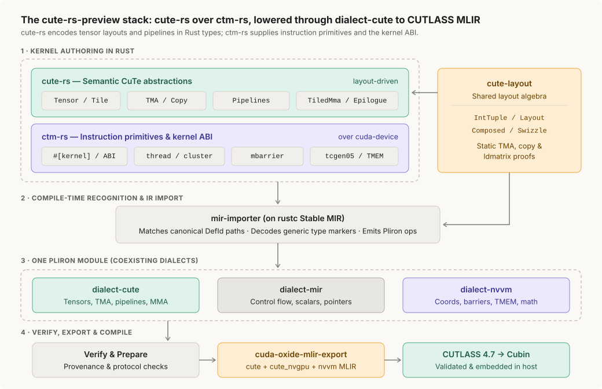

# cute-rs: CuTe kernels in Rust (preview)

> **Preview.** `cute-rs` compiles Rust CuTe kernels ahead of time through the pinned
> CUTLASS 4.7 compiler for three targets, `sm_100a` (B200 class), `sm_103a`
> (B300 class) and `sm_120a` (RTX 50 series). Every other architecture is rejected before compilation. It covers
> a validated subset of CuTeDSL 4.7, not feature parity; the
> [support matrix](../cuda-oxide-book/cute/support-matrix.md) lists what is in and
> what is not. APIs can change between releases.

Layouts, swizzles, operand roles, TMA pipelines and tensor-core MMA are Rust types.
The compiler decodes them, verifies the whole module, and hands CUTLASS MLIR to the
pinned compiler. No Python interpreter, no runtime tracer.



| Crate | Role |
| --- | --- |
| [`cute-rs`](cute-rs/README.md) | tensors, tiles, copies, pipelines and tiled MMA; the kernel-facing API |
| [`ctm-rs`](ctm-rs/README.md) | typed instruction primitives beneath it: TMA, mbarrier, tcgen05, TMEM, mma.sync |
| [`cute-layout`](cute-layout/README.md) | layout algebra and the compile-time proofs shared with the compiler |
| [`dialect-cute`](dialect-cute/README.md) | the Pliron dialect and the whole-module verifier |

## Run

```bash
cargo oxide toolchain install cutlass          # once
CUDA_OXIDE_DEVICE_BACKEND=cutlass-mlir cargo oxide run elementwise_cute --arch sm_120a
CUDA_OXIDE_DEVICE_BACKEND=cutlass-mlir cargo oxide run blockscale_gemm_cute --arch sm_120a
CUDA_OXIDE_DEVICE_BACKEND=cutlass-mlir cargo oxide build fp16_gemm_256x352_cute --arch sm_100a
```

`elementwise_cute` checks every `f32` and `f16` bit pattern against a host reference.
The GEMM examples validate against a CPU reference and print their timings. Add
`CUDA_OXIDE_MLIR_OUTPUT="$PWD/module.mlir"` to a `build` to keep the MLIR text.
[Build with the CUTLASS compiler](../cuda-oxide-book/cute/build-with-cutlass.md) has
the options and the failure rules.

## Examples

| Example | Target | Shows |
| --- | --- | --- |
| [`elementwise_cute`](examples/elementwise_cute) | `sm_120a`, `sm_100a` | 1D tiles, vectorized copy, scalar tail |
| [`swiglu_cute`](examples/swiglu_cute) | `sm_120a` | register transforms, FP32 math, FP16 output |
| [`rmsnorm_cute`](examples/rmsnorm_cute) | `sm_120a` | warp reductions, explicit BF16 rounding |
| [`ffn_cute`](examples/ffn_cute) | `sm_120a` | BF16 `mma.sync` projections with typed weight roles |
| [`rope_cache_cute`](examples/rope_cache_cute) | `sm_120a` | RoPE, owned KV cache, GQA attention |
| [`nvfp4_gemv_cute`](examples/nvfp4_gemv_cute) | `sm_120a` | packed FP4 with block scales on CUDA cores |
| [`blockscale_gemm_cute`](examples/blockscale_gemm_cute) | `sm_120a` | MXFP4 GEMM: 3-stage TMA ring, tensor cores, TMA-store epilogue |
| [`blockscale_gemm_ctm`](examples/blockscale_gemm_ctm) | `sm_120a` | the same GEMM on `ctm-rs` alone |
| [`fmha_prefill_sm120a_cute`](examples/fmha_prefill_sm120a_cute) | `sm_120a` | FP16 D64 prefill, causal or dense |
| [`fmha_decode_sm120a_cute`](examples/fmha_decode_sm120a_cute) | `sm_120a` | FP16 D64 decode with split-KV reduction |
| [`fp16_gemm_256x352_cute`](examples/fp16_gemm_256x352_cute) | `sm_100a` | two-CTA GEMM: cluster TMA, TMEM, A-collector reuse |
| [`fp16_gemm_256x352_ctm`](examples/fp16_gemm_256x352_ctm) | `sm_100a` | the same GEMM on `ctm-rs` alone |
| [`sm100_fmha_prefill_cute`](examples/sm100_fmha_prefill_cute) | `sm_100a` | FP16 D128 prefill, MHA or GQA, warp specialized |
| [`sm100_mla_decode_fp16_cute`](examples/sm100_mla_decode_fp16_cute) | `sm_100a` | MLA decode with a paged latent cache and two-CTA clusters |

| Model | Target | Scope |
| --- | --- | --- |
| [`qwen_decoder_cute`](models/qwen_decoder_cute) | `sm_120a` | Qwen3-TTS 1.7B end to end, text in and waveform out ([visual guide](models/qwen_decoder_cute/visual.md)) |
| [`qwen3_8b_cute`](models/qwen3_8b_cute) | `sm_120a` | 36-layer Qwen3-8B decoder in BF16 and NVFP4 ([visual guide](models/qwen3_8b_cute/visual.md)) |

`cargo oxide list` prints both tables. Each README gives the device requirement, one
command and the expected result; the `reference/` folders hold the comparison
harnesses, the pinned reference sources and the validation commands.

## Read next

- [Overview](../cuda-oxide-book/cute/overview.md): the two-layer stack and a first kernel.
- [From CuTeDSL to cute-rs](../cuda-oxide-book/cute/cutedsl-comparison.md): why the kernel signatures differ and how Rust types become CuTe IR.
- [Layouts and tiling](../cuda-oxide-book/cute/layouts-and-tiling.md) and [GEMM and pipelines](../cuda-oxide-book/cute/gemm-and-pipelines.md).
- [Checks and obligations](../cuda-oxide-book/cute/contracts.md): what the compiler proves and what you own.

## Compiler boundary

The importer matches `cute-rs` types and methods by their rustc definition path, not by
re-export. Moving a recognised type or inherent `impl` changes its compiler identity;
update the importer decoders and the collector paths together, and keep compiler hooks
in `__compiler` modules. Host tests do not exercise the importer: verify a boundary
change with the identity tests, the compile-fail tests and a device build.
[AGENTS.md](AGENTS.md) states the kernel architecture rules.
