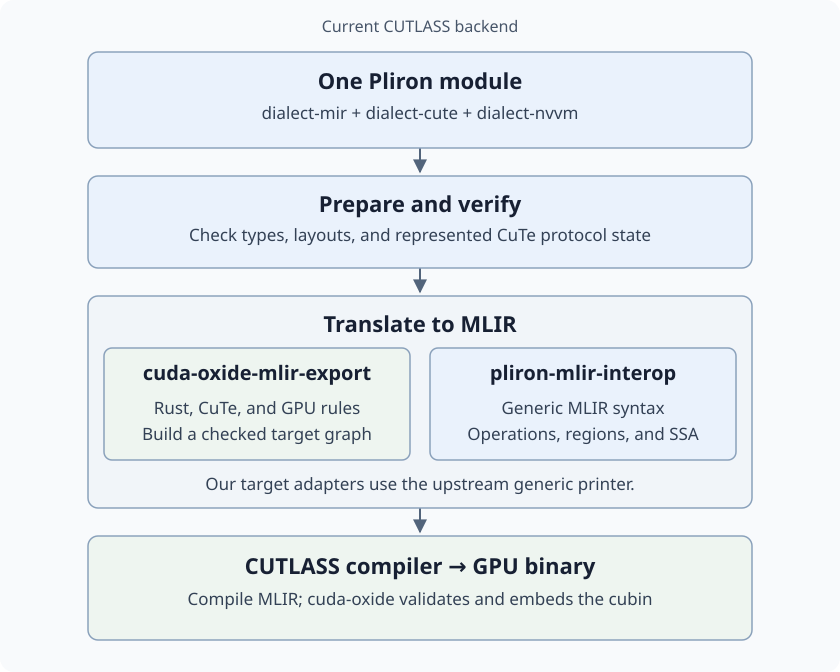

# How our Pliron operations become MLIR

For the CUTLASS backend, cuda-oxide translates a Pliron program into MLIR text,
then asks the pinned CUTLASS compiler to build the GPU binary.

`dialect-mir`, `dialect-cute`, and `dialect-nvvm` can all appear in the same
module. They describe different parts of the program; they are not three
successive compilation stages.

## What gets mapped?

| Pliron input | MLIR output |
| --- | --- |
| MIR arithmetic, functions, branches, and memory | `arith`, `func`, `cf`, and `llvm` operations |
| CuTe tensors, copies, and matrix multiplication | CUTLASS `cute` / `cute_nvgpu` operations and supporting instructions |
| NVVM thread-index reads and supported GPU instructions | MLIR `nvvm` operations or instruction sequences |

For example, an integer `mir.add` becomes `arith.addi`. A thread-index read
becomes `nvvm.read.ptx.sreg.tid.x`.

Mapping includes types and attributes, not just operation names. A single
source operation can expand into several target operations. Compile-time
CuTe state can disappear after its checks have succeeded.

## Which crate does what?

- **`cuda-oxide-mlir-export` supplies the rules and target graph:** Rust layouts,
  CuTe operations, and GPU instructions map to the selected CUTLASS version.
  Its registry keeps value and block connections checked. Unregistered source
  operations, types, and attributes remain errors.
- **Upstream `pliron-mlir-interop` prints the target graph:** locally owned
  adapters implement `ToMlirOp`, `ToMlirType`, and `ToMlirAttr`. The upstream
  `GenericOp` builder renders operations, regions, blocks, and SSA connections.
- **CUTLASS compiles the text:** cuda-oxide extracts and validates the resulting
  cubin, then embeds it for the normal CUDA launch path.

The mapping recipes can expand one source operation into several target
operations before printing. They retain control of types, inherent operation
properties, discardable attributes, and locations.

Shared preparation and CuTe verification happen before export. Checks cover
the represented layouts and protocol state; dynamic thread participation,
phases, and pointer lifetimes still have caller obligations.

The native backend takes a separate route through LLVM. This diagram describes
`CUDA_OXIDE_DEVICE_BACKEND=cutlass-mlir`.

## Where upstream interop fits

[`pliron-mlir-interop` 0.1.0](https://crates.io/crates/pliron-mlir-interop/0.1.0)
is the generic printing dependency, pinned from crates.io alongside Pliron
0.20.0. cuda-oxide materializes its translated plan
as a separate Pliron target graph, then uses upstream's interfaces and printer.
Its MIR, CuTe, and NVVM recipes and CUTLASS version policy remain here.

For example, MIR loads and stores become target `llvm` operations through our
memory mappings. They do not pass through upstream's bundled LLVM source-dialect
translations. The adapter carries the properties those mappings selected,
including volatile memory behavior and address spaces.

The local adapter preserves typed discardable attributes and individual block
argument locations through the published API. The
[interop reference](reference/pliron-mlir-interop.md) records that compatibility
contract and the earlier migration results.

## Read or run it

- [Build with the CUTLASS backend](translation.md).
- [Our mapping rules](../../crates/cuda-oxide-mlir-export/README.md).
- [The target adapter](../../crates/cuda-oxide-mlir-export/src/interop/mod.rs).
