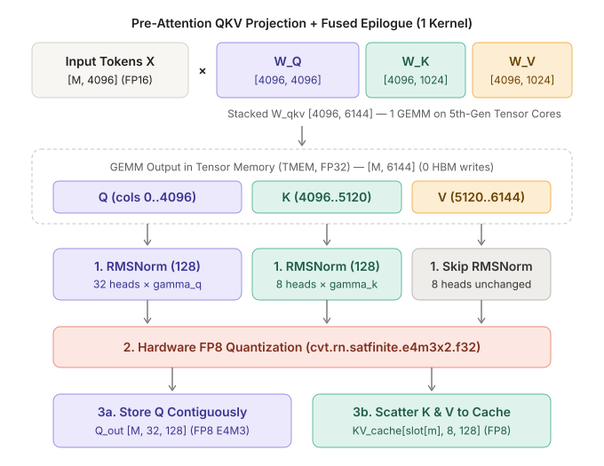
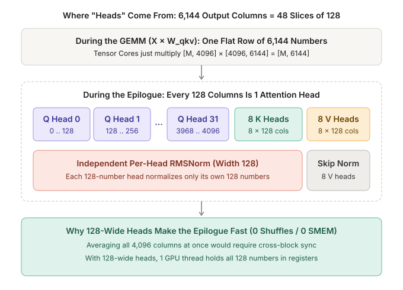
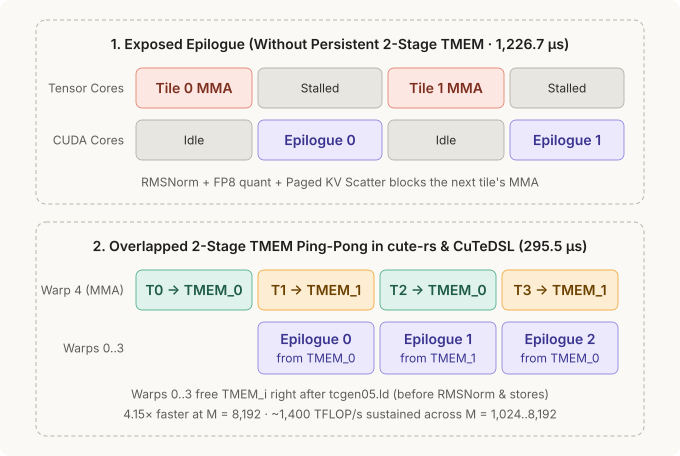
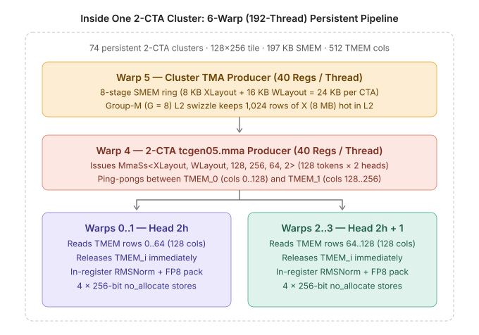

# Fused QKV + Epilogue on B200 (`sm_100a`), end to end

> Every attention layer starts with the same chore: take `M` incoming token rows, multiply them by `W_Q`, `W_K`, and `W_V`, normalize `Q` and `K` per head, quantize everything to `FP8`, write `Q` out for FlashAttention, and scatter `K` and `V` into the Paged KV Cache. Doing all of that in **one kernel** without stalling the Tensor Cores is what this example is all about.

---

## 1 · One GEMM, Three Epilogue Paths

Instead of launching three separate matrix multiplies for `Q`, `K`, and `V`, we glue the weight matrices side by side into **`W_qkv [4096, 6144]`**:
- **First `4,096` columns**: `Q` (`32` heads × `128` wide)
- **Next `1,024` columns**: `K` (`8` heads × `128` wide)
- **Last `1,024` columns**: `V` (`8` heads × `128` wide)

The 5th-Gen Tensor Cores (`tcgen05.mma`) multiply `X [M, 4096] × W_qkv [4096, 6144]` and deposit the FP32 accumulators into on-chip **Tensor Memory (`TMEM`)**. Depending on which column slice a tile belongs to, the epilogue either:
1. Normalizes each 128-wide head (`RMSNorm`), quantizes to `FP8 (e4m3fn)`, and stores contiguously to `Q_out` (`Q` columns),
2. Normalizes each 128-wide head (`RMSNorm`), quantizes to `FP8 (e4m3fn)`, and scatters into `k_cache[slot_mapping[m]]` (`K` columns), or
3. Skips `RMSNorm`, quantizes to `FP8 (e4m3fn)`, and scatters into `v_cache[slot_mapping[m]]` (`V` columns).

---

## 2 · Where "Heads" Come From (And Why They Make the Epilogue Fast)

During the matrix multiply itself, there are **no heads**: just a `[M, 6144]` output grid.

"Heads" appear in the epilogue because **QK-Norm (`RMSNorm`) is defined per 128-column attention head**, not across the whole `4,096`-wide row:
- Slicing a `6,144`-wide row into `48` chunks of `128` (`32` Q heads + `8` K heads + `8` V heads) moves **zero data**.
- Because our 2-CTA tile covers `M = 128` tokens × `N = 256` columns (`= 2` complete `128`-wide heads), hardware `tcgen05.mma` (`cta_group::2`) places `Head 2h` in TMEM rows `0..64` (`Warps 0..1`) and `Head 2h + 1` in TMEM rows `64..128` (`Warps 2..3`).
- When an epilogue thread calls `TmemFragment::<128>::load`, **one thread receives all 128 numbers of one head for one token right in its own registers**. It computes the sum of squares, `rsqrt`, gamma scaling, and `FP8` packing without a single warp shuffle or shared-memory reduction!

---

## 3 · Hiding the Epilogue with 2-Stage `TMEM` Ping-Pong

With a single accumulator buffer, each tile's epilogue (`RMSNorm`, `FP8` quantization, and indirect page-table scatters) runs sequentially after its GEMM (**top diagram**). At `M = 8,192`, that exposed schedule takes **`1,226.7 µs`**.

In both **Python `CuTeDSL`** and **`cute-rs`** (**bottom diagram**), we allocate **two accumulator stages (`TMEM_0` at columns `0..128`, `TMEM_1` at columns `128..256`)** and release `TMEM_i` **the instant `tcgen05.ld` finishes**, before `RMSNorm`, `FP8` quantization, and HBM scatters even begin. That drops `M = 8,192` latency to **`295.5 µs` (`4.15×` faster, `1,395.3 TFLOP/s`)**.

---

## 4 · Inside One 2-CTA Cluster (`192` Threads = `6` Warps per CTA)

Each CTA splits its `192` threads across three specialized warp roles:
- **`Warp 5` (Cluster TMA Producer, `40` regs/thread)**: Streams 8 stages of `X` (`64×64` per CTA) and `W_qkv` (`128×64` per CTA) using group-M (`G = 8`) L2 swizzling so `1,024` rows of `X` (`8 MB`) stay hot in B200's L2 cache.
- **`Warp 4` (`tcgen05.mma` Producer, `40` regs/thread)**: Issues `MmaSs<XLayout, WLayout, 128, 256, 64, 2>` alternating between `TMEM_0` and `TMEM_1`.
- **`Warps 0..3` (Register-Direct Epilogue, `232` regs/thread)**: Unloads `TmemFragment<128>`, immediately releases `TMEM_i`, runs `RMSNorm` + `cvt.rn.satfinite.e4m3x2.f32`, and writes four 256-bit (`32`-byte = 1 full L2 sector) `L1::no_allocate` stores (`store_global_no_allocate::<u32, 8>`) to `Q_out` or `KV_cache`.
