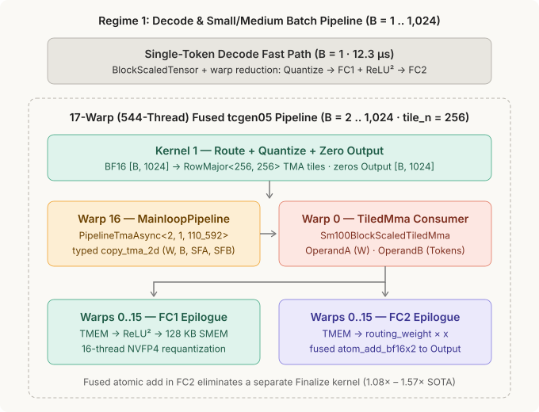
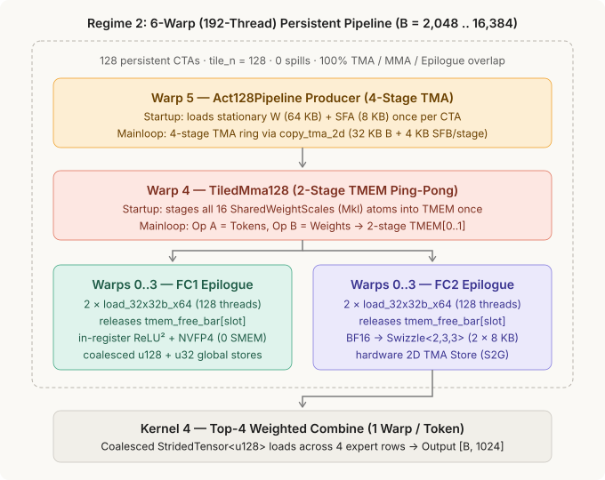

# Nemotron-3 NVFP4 ReLU² Mixture-of-Experts (`nemotron3_moe_cute`)

`cute-rs` (`cutlass-mlir` / CUTLASS 4.7) implementation of **one complete Mixture-of-Experts (MoE) layer** from **NVIDIA Nemotron-3** on Blackwell (`sm_100a`), using hardware block-scaled **NVFP4** (`Float4E2M1FN` values + `Float8E4M3FN` scales, `1` scale per `16` values) and non-gated **`ReLU²(x) = max(0, x)²`** activation.

---

## 1. What We Measure (One Full MoE Layer in a Captured CUDA Graph)

| Parameter | Value | Description |
| :--- | :--- | :--- |
| **Hidden size (`H`)** | `1,024` | Input and output token embedding dimension (`BFloat16`) |
| **Intermediate size (`I`)** | `1,024` | Per-expert FFN width (`FC1: 1024 -> 1024`, `FC2: 1024 -> 1024`) |
| **Experts (`E`) / Top-K (`K`)** | `8` / `4` | Each token routes to `4` of `8` experts (`4 × B` routed token-expert pairs) |
| **Precision** | `NVFP4` | `Float4E2M1FN` weights/activations + `Float8E4M3FN` block scales (`SF_VEC = 16`) |
| **Batch sizes (`B`)** | `1 .. 16,384` | All 15 power-of-two token batch sizes verified against a CPU oracle |

Every implementation captures the **exact same end-to-end MoE layer** (`BF16 Input -> Quantize -> Route -> FC1 + ReLU² + Requantize -> FC2 + Top-4 Combine -> BF16 Output`) inside a single CUDA Graph and measures mean latency over **`1,000` graph replays**:

```text
BeginCapture                                                                 EndCapture
┌─────────────────────────────────────────────────────────────────────────────────────┐
│  [K1: Quantize BF16->FP4] ──► [K2: Route] ──► [K3: FC1+ReLU²] ──► [K4: FC2+Combine] │
└─────────────────────────────────────────────────────────────────────────────────────┘
Start CUDA Event ──► Replay Captured Graph 1,000× ──► Stop CUDA Event (mean = total / 1000)
```

---

## 2. How CuTe Is Encoded in Rust's Type System

All shared-memory tile shapes, swizzled TMA descriptors, producer/consumer warp pipelines, operand roles, and 5th-Gen Tensor Core (`tcgen05.mma`) operations are encoded in Rust types and verified by `dialect-cute`:

```text
┌────────────────────────────────────────────────────────────────────────────────────────┐
│  1. Compile-Time Layouts & Typed TMA Descriptors (`#[grid_constant]`)                  │
│     type WeightTileSmem     = RowMajor<128, 256>;   // 32,768 B (K=512 FP4 weights)    │
│     type ActTileSmem        = RowMajor<256, 256>;   // 65,536 B (B <= 1024 tokens)     │
│     type ActTile128Smem     = RowMajor<128, 256>;   // 32,768 B (B >= 2048 tokens)     │
│     type ScaleTmaSmem       = RowMajor<8, 256>;     //  4,096 B (8 scale atoms)        │
│     type GroupedOutTileSmem = ComposedLayout<Swizzle<2, 3, 3>, 0, RowMajor<128, 32>>;  │
│     #[grid_constant] w_up_tma:        &TensorMap<u8,  WeightTileSmem>                  │
│     #[grid_constant] grouped_out_tma: &TensorMap<u16, GroupedOutTileSmem>              │
├────────────────────────────────────────────────────────────────────────────────────────┤
│  2. Warp-Specialized Producer/Consumer TMA Pipelines (`PipelineTmaAsync`)              │
│     type MainloopPipeline = PipelineTmaAsync<2, 1, 110_592>; // 2-Stage (B <= 1024)    │
│     type Act128Pipeline   = PipelineTmaAsync<4, 1,  36_864>; // 4-Stage (B >= 2048)    │
│     • Producer Warp (`PipelineState<Producer, STAGES>`):                               │
│         producer_acquire ──► producer_expect_tx ──► copy_tma_2d ──► producer_tail      │
│     • MMA Consumer Warp (`PipelineState<Consumer, STAGES>`):                           │
│         consumer_wait ──► TiledMma ──► consumer_release ──► advance                    │
├────────────────────────────────────────────────────────────────────────────────────────┤
│  3. Role-Checked Shared Tiles, Block-Scaled MMA & Staged TMEM Epilogue                 │
│     type SharedWeightTile   = Sm100SharedTile<WeightTileSmem, OperandA>;               │
│     type SharedAct128Tile   = Sm100SharedTile<ActTile128Smem, OperandB>;               │
│     type SharedWeightScales = Sm100ScaleTile<Mkl>;                                     │
│     type SharedActScales    = Sm100ScaleTile<Nkl>;                                     │
│     type TiledMma128        = Sm100BlockScaledTiledMma<WeightTileSmem, ActTile128Smem>;│
│     type StagedEpilogue     = Sm100TmemStagedEpilogue<EpilogueSmem, 128>;              │
└────────────────────────────────────────────────────────────────────────────────────────┘
```

---

## 3. Architecture Across Both Batch Regimes

### Regime 1: Decode & Small/Medium Batch (`B = 1 .. 1,024` · `tile_n = 256`, Fused `atom_add_bf16x2`)



* **`B = 1` (Single-Token Decode):** Runs `moe_fc1_relu2_cute` and `moe_fc2_cute` over `BlockScaledTensor` and `warp_reduction_sum_f32` (`12.30 µs` vs. `18.43 µs` SOTA).
* **`B = 2 .. 1,024` (`17`-Warp / `544`-Thread `tcgen05` Pipeline):** `Warp 16` drives `MainloopPipeline` (`PipelineTmaAsync<2, 1, 110_592>`), `Warp 0` issues `TiledMma` with adaptive `valid_n` (`16 .. 256`), and `Warps 0..15` (`512` threads) fuse `routing_weight × x` and `atom_add_bf16x2` inside `StagedEpilogue::unload_and_atomic_add_bf16x2` (`1.08x – 1.57x` faster than SOTA).

---

### Regime 2: Large Batch / Prefill (`B = 2,048 .. 16,384` · `tile_n = 128`, 6-Warp Persistent Pipeline)



At `B = 2,048 .. 16,384`, `moe_fc1_relu2_tcgen05_128_cute` and `moe_fc2_tcgen05_128_cute` launch `128` persistent CTAs with **`6` warps (`192` threads)** per CTA (`0` stack spills), keeping expert weights stationary in `SMEM_A` + `TMEM[256..319]`, streaming `128`-token groups through `Act128Pipeline` (`PipelineTmaAsync<4, 1, 36_864>`), ping-ponging across **2-stage `TMEM` (`cols 0..127` / `cols 128..255`)**, and overlapping `TiledMma128` with `StagedEpilogue` 100%.

---

## 4. Quick Start (Build & Run)

Run the **`cute-rs` (`cutlass-mlir`)** model (from anywhere in the repository):

```bash
CUDA_OXIDE_DEVICE_BACKEND=cutlass-mlir cargo oxide run nemotron3_moe_cute --arch sm_100a
```

Run the **Native `cuda-oxide` SIMT** counterpart:

```bash
cargo oxide run nemotron3_moe --arch sm_100a
```

---

## 5. Source Layout

* [`src/main.rs`](src/main.rs) — Typed CuTe layouts, TMA descriptors, kernels (`quantize_activations_nvfp4`, `moe_fc1_relu2_cute`, `moe_fc1_relu2_tcgen05_cute`, `moe_fc1_relu2_tcgen05_128_cute`, `moe_fc2_cute`, `moe_fc2_tcgen05_cute`, `moe_fc2_tcgen05_128_cute`, `moe_finalize_cute`), CPU oracle, and CUDA Graph benchmark harness.
* [`reference/`](reference/) — Standalone FlashInfer CuTeDSL (`flashinfer.fused_moe.cute_dsl_fused_moe`, `w4a4` + `Relu2`) reproduction script ([`reference/benchmark_flashinfer.py`](reference/benchmark_flashinfer.py)) and instructions ([`reference/README.md`](reference/README.md)).
* [`../../cute-rs/src/sm100/mma.rs`](../../cute-rs/src/sm100/mma.rs) — `Sm100BlockScaledTiledMma` (`copy_a_scales_burst`, `copy_b_scales_and_gemm_burst`, `copy_b_scales_and_gemm_128_burst`, `load_stationary_weights_2d`).
* [`../../cute-rs/src/sm100/tmem.rs`](../../cute-rs/src/sm100/tmem.rs) — `Sm100TmemStagedEpilogue` (`unload_relu2_to_shared`, `unload_and_atomic_add_bf16x2`, `unload_relu2_and_quantize_128`, `unload_and_tma_store_bf16_128`).

---

## 6. Measured B200 (`sm_100a`) CUDA Graph Latency (`B = 1 .. 16,384`, `max_error = 0.000000`)

```text
Batch size | FlashInfer CuTeDSL (us) |  Native SIMT [ref] (us) |    cute-rs [live] (us) | cute-rs vs. SOTA
-----------+-------------------------+-------------------------+------------------------+-----------------
         1 |                  18.430 |                  12.282 |                 12.295 |       1.50x SOTA
         2 |                  18.420 |                  14.329 |                 14.344 |       1.28x SOTA
         4 |                  18.420 |                  14.345 |                 14.331 |       1.29x SOTA
         8 |                  18.440 |                  14.345 |                 14.345 |       1.29x SOTA
        16 |                  20.390 |                  14.344 |                 14.337 |       1.42x SOTA
        32 |                  19.800 |                  14.345 |                 14.345 |       1.38x SOTA
        64 |                  20.490 |                  14.509 |                 14.345 |       1.43x SOTA
       128 |                  22.520 |                  14.345 |                 14.345 |       1.57x SOTA
       256 |                  23.240 |                  16.387 |                 16.377 |       1.42x SOTA
       512 |                  24.570 |                  18.583 |                 19.231 |       1.28x SOTA
      1024 |                  28.750 |                  24.590 |                 26.612 |       1.08x SOTA
      2048 |                  38.890 |                  32.183 |                 32.785 |       1.19x SOTA
      4096 |                  51.250 |                  49.144 |                 51.194 |       1.00x SOTA
      8192 |                  92.610 |                  88.325 |                 90.341 |       1.03x SOTA
     16384 |                 179.350 |                 174.825 |                173.897 |       1.03x SOTA
```
