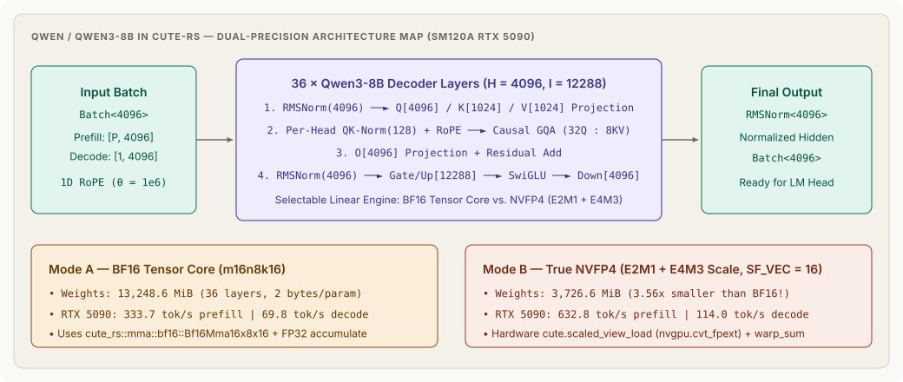

# qwen3_8b_cute: Qwen/Qwen3-8B in cute-rs (BF16 & NVFP4 on RTX 5090)

End-to-end 36-layer **Qwen/Qwen3-8B** transformer decoder (`H = 4096`, `I = 12288`, `Q = 32`, `KV = 8`, `D = 128`, `RoPE θ = 1e6`, per-head `QK-Norm`) written in Rust with [cute-rs](../../cute-rs), supporting both **BF16 Tensor-Core MMA** and **true NVFP4 (`Float4E2M1FN` + `Float8E4M3FN` scale, `SF_VEC = 16`)** execution on Blackwell (`sm_120a`).

<p align="center">
  
</p>

👉 **[Read the Visual Architecture Guide (`visual.md`)](visual.md)** for a diagram-by-diagram walkthrough of the 36-layer GQA decoder and NVFP4 (`Float4E2M1FN` + `Float8E4M3FN`) block scaling.

---

## RTX 5090 (sm_120a) Live Benchmark: Full 36 Layers (cute-rs vs. CuTeDSL)

<p align="center">
  
</p>

| Implementation & Precision Mode | 36-Layer Weight Footprint | Compression | Prefill (`32` tok) | Decode (`B = 1`) |
| --- | ---: | ---: | ---: | ---: |
| **cute-rs NVFP4 (`Float4E2M1FN` + `Float8E4M3FN`, `SF_VEC = 16`)** | **`3,726.59 MiB` (`3.64 GiB`)** | **`3.56×`** | **`50.57 ms` (`632.8 tok/s`)** | **`8.77 ms/tok` (`114.0 tok/s`)** |
| **CuTeDSL (`cutlass.cute`) NVFP4 Reference** | `3,726.59 MiB` (`3.64 GiB`) | `3.56×` | `53.08 ms` (`602.9 tok/s`) | `13.20 ms/tok` (`75.8 tok/s`) |
| **cute-rs BF16 (`m16n8k16` Tensor Core)** | `13,248.59 MiB` (`12.94 GiB`) | `1.00×` | `95.89 ms` (`333.7 tok/s`) | `14.32 ms/tok` (`69.8 tok/s`) |

### Why cute-rs NVFP4 Wins (At a Glance)

```text
1. 3.56× Less Memory Traffic per Token (NVFP4 vs. BF16)
   BF16  weights : [████████████████████████████] 12.94 GiB read/token  ──►  69.8 tok/s
   NVFP4 weights : [████████]                      3.64 GiB read/token  ──► 114.0 tok/s (1.63× faster)

2. Coalesced 32-Lane Warp Reduction + Async Stream Execution (cute-rs vs. CuTeDSL)
   CuTeDSL (1 thread/row) : 32 threads read 32 different rows (strided) ──►  75.8 tok/s decode
   cute-rs (1 warp/row)   : 32 lanes read 1 row along K (1 KB coalesced) ──► 114.0 tok/s decode (1.50× faster)
```

- **NVFP4 vs. BF16 (`1.89×` prefill, `1.63×` decode):** Reading `3.64 GiB` instead of `12.94 GiB` per token cuts memory traffic by `3.56×`, and `Nvfp4Tile64::load()` lowers directly to Blackwell hardware `nvgpu.cvt_fpext`.
- **cute-rs (1 warp/output) vs. CuTeDSL (1 thread/output):** Assigning a 32-lane warp to each output row coalesces global `K`-tile loads and saturates all 170 SMs on the RTX 5090, while stream-ordered async execution over pre-allocated `Nvfp4Scratch` buffers eliminates per-layer host synchronization (**`632.8` vs. `602.9 tok/s` prefill**, **`114.0` vs. `75.8 tok/s` decode**).

---

## Quick Start

From `cuda-oxide/`, once per checkout:

```bash
cargo oxide toolchain install cutlass
python3 -m venv cute-rs-preview/.venv
cute-rs-preview/.venv/bin/pip install -r cute-rs-preview/requirements.txt
```

Then:

```bash
# Quick 4-layer validation + benchmark on RTX 5090 (sm_120a)
CUDA_OXIDE_DEVICE_BACKEND=cutlass-mlir \
  cargo oxide run qwen3_8b_cute --arch sm_120a -- --layers 4 --prompt-len 16 --decode-steps 8

# Full 36-layer Qwen/Qwen3-8B benchmark (synthesizes weights on GPU in <50 ms)
CUDA_OXIDE_DEVICE_BACKEND=cutlass-mlir \
  cargo oxide run qwen3_8b_cute --arch sm_120a -- --full --prompt-len 32 --decode-steps 16

# Load a local HuggingFace Qwen/Qwen3-8B safetensors directory
CUDA_OXIDE_DEVICE_BACKEND=cutlass-mlir \
  cargo oxide run qwen3_8b_cute --arch sm_120a -- --full --checkpoint /path/to/Qwen3-8B

# Run CPU unit tests and rustdoc doctests
cargo test --manifest-path cute-rs-preview/models/qwen3_8b_cute/Cargo.toml

# Run the CuTeDSL (cutlass.cute) Python reference benchmark on RTX 5090
cute-rs-preview/.venv/bin/python cute-rs-preview/models/qwen3_8b_cute/reference/benchmark_cutedsl.py --layers 36 --prompt-len 32 --decode-steps 16
```

---

## Module Map

| File | Responsibility |
| --- | --- |
| [`src/config.rs`](src/config.rs) | `Qwen/Qwen3-8B` dimensions (`HIDDEN = 4096`, `INTERMEDIATE = 12288`, `LAYERS = 36`, `Q_HEADS = 32`, `KV_HEADS = 8`, `HEAD_DIM = 128`) and memory footprint helpers. |
| [`src/nvfp4.rs`](src/nvfp4.rs) | True NVFP4 (`Float4E2M1FN` + `Float8E4M3FN` scale, `SF_VEC = 16`) quantizer, canonical `(32, 4)` Blackwell scale-atom layout, and hardware-lowered `cute.scaled_view_load` (`nvgpu.cvt_fpext`) GPU projection kernels. |
| [`src/checkpoint.rs`](src/checkpoint.rs) | Multi-shard `model.safetensors.index.json` loader for `Qwen/Qwen3-8B` plus fast GPU synthetic weight generator. |
| [`src/benchmark.rs`](src/benchmark.rs) | `Qwen3Engine` executing both BF16 and NVFP4 stacks with KV caching, prefill/decode timing, and cosine-similarity verification. |
| [`reference/benchmark_cutedsl.py`](reference/benchmark_cutedsl.py) | CuTeDSL (`cutlass.cute`) Python reference implementation and RTX 5090 benchmark harness. |
| [`visual.md`](visual.md) | Visual walkthrough with adaptive light/dark SVG diagrams. |
