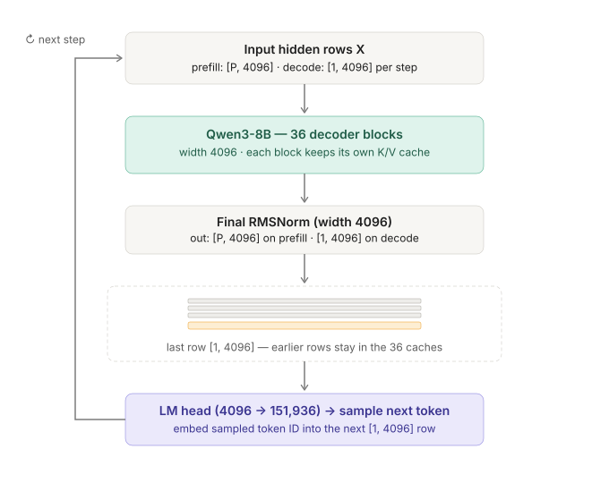
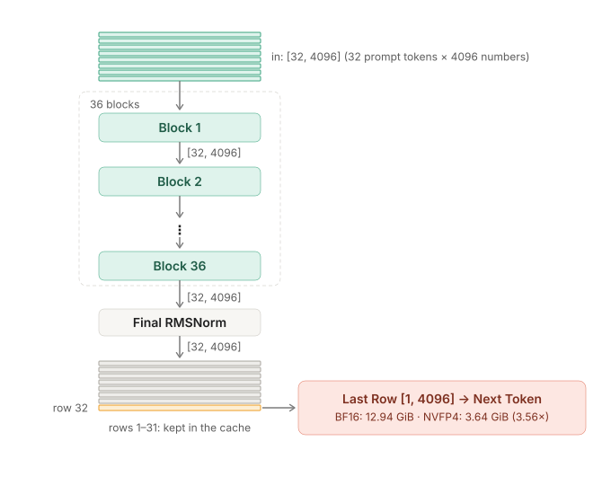
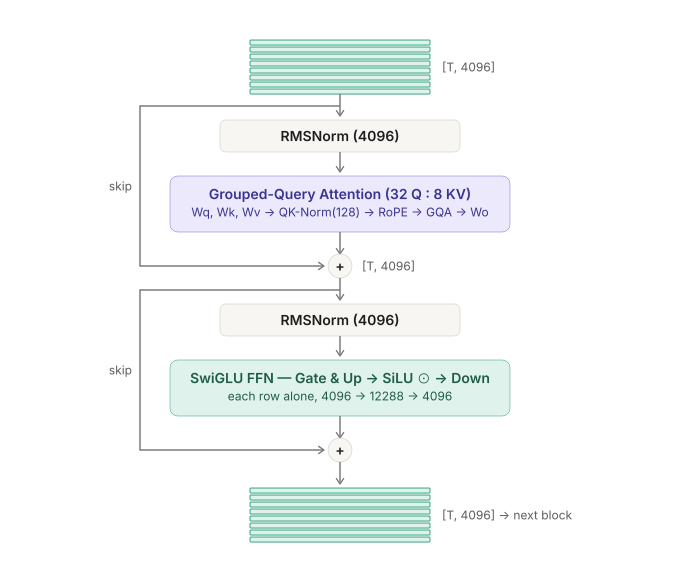
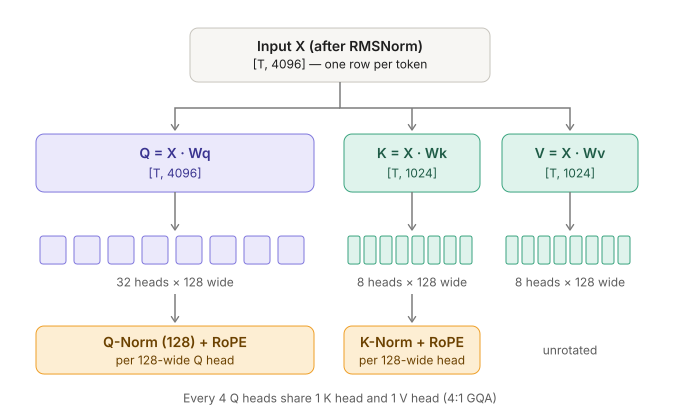
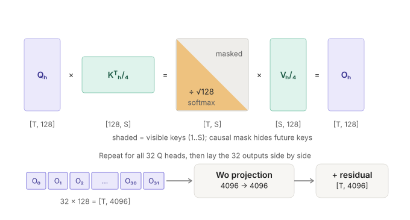
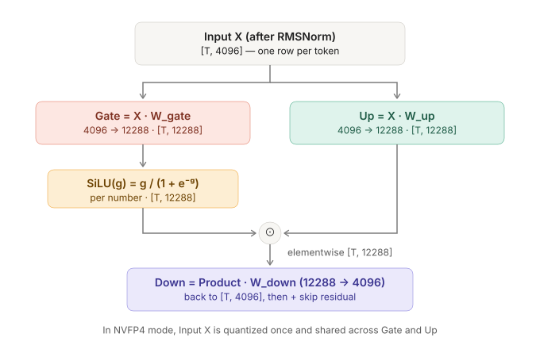
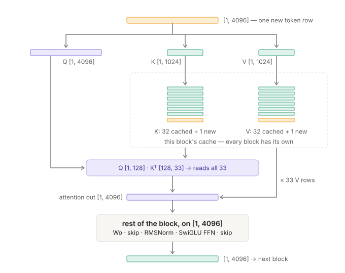
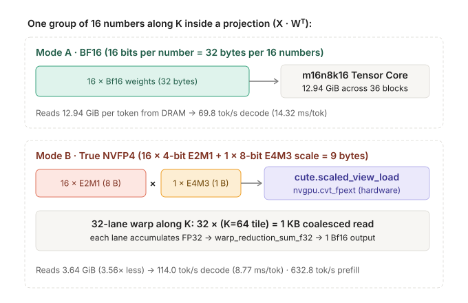
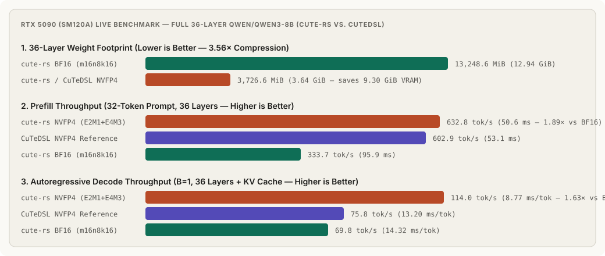

# Qwen3-8B, end to end

> A causal language decoder takes a matrix of token rows in (`[P, 4096]` during prefill, `[1, 4096]` on each decode step), passes those rows through **36 identical blocks**, and uses the last output row to pick the next token. Every block keeps its own key/value cache so earlier rows are never recomputed.

In `qwen3_8b_cute`, the normalization, rotary position embedding, and grouped-query attention spine stays in BF16/FP32 while all **252 linear projection matrices** (`7 per block × 36 blocks`) can run either in **BF16 (`12.94 GiB`)** or in **Blackwell NVFP4 (`E2M1` + `E4M3` scale, `3.64 GiB`)**.

Model: `Qwen/Qwen3-8B`. Example prompt throughout: `P = 32` prompt rows of width `4096`, followed by `B = 1` autoregressive decode steps.

## 0 · The whole loop

**row**: one token position represented as `4096` numbers (`[1, 4096]`). **prefill**: all `32` prompt rows (`[32, 4096]`) pass through the 36 blocks together; rows `1–31` stay inside the 36 K/V caches, and only the last row (`[1, 4096]`) is needed to predict the first new token. **decode**: each subsequent step feeds just the newly generated token (`[1, 4096]`) back through the 36 blocks.

## 1 · The 36-block stack from the outside

Every block takes `[T, 4096]` in and produces `[T, 4096]` out (`T = 32` in prefill, `T = 1` in decode), so all 36 blocks stack without adapters. Across 36 blocks, the 252 weight matrices occupy **12.94 GiB** in BF16 (`2 bytes/weight`) or **3.64 GiB** in NVFP4 (`4.5 bits/weight` effective, a **3.56×** reduction).

## 2 · One of the 36 blocks

**skip**: the raw input (taken before the `RMSNorm`) is added back, element by element, to the sub-block's output (`+`). The first half (**Attention**) lets each token row read earlier token rows; the second half (**SwiGLU FFN**) processes each token row on its own (`4096 → 12288 → 4096`).

## 3 · Inside attention, part 1: X → Q, K, V → heads + QK-Norm + RoPE

**projection**: multiply `[T, 4096]` by a weight matrix `W`. `Wq` keeps the width at `4096` (`32 heads × 128`), while `Wk` and `Wv` shrink `4096 → 1024` (`8 heads × 128`). **QK-Norm**: unlike older Llama/Qwen2 models, Qwen3 applies an independent `RMSNorm(128)` to every 128-wide Q head and K head before rotating them with **RoPE** (`θ = 1,000,000`). **4:1 GQA**: every group of 4 query heads shares 1 key head and 1 value head.

## 4 · Inside attention, part 2: one head's QKᵀ / √128, then merging all 32 heads

`T` = rows coming in now (`32` in prefill, `1` in decode); `S` = total rows visible in the cache. For one query head `h`, multiplying `Qₕ [T, 128]` by `Kᵀₕ/₄ [128, S]` gives a `[T, S]` score table, scaled by `1 / √128`. The causal mask hides future positions, `softmax` turns each row into weights that sum to `1`, and multiplying by `Vₕ/₄ [S, 128]` produces `Oₕ [T, 128]`. Laying all 32 heads side by side restores `[T, 4096]`, which `Wo` (`4096 → 4096`) mixes before the first `+ skip`.

## 5 · Inside the FFN: Gate, Up, SiLU, and Down (4096 → 12288 → 4096)

Each token row (`[1, 4096]`) is widened 3× by two parallel projections: **Gate** (`4096 → 12288`) and **Up** (`4096 → 12288`). `Gate` passes element-by-element through `SiLU(g) = g / (1 + e⁻ᵍ)`, multiplies elementwise (`⊙`) with `Up`, and **Down** (`12288 → 4096`) shrinks the row back to `4096` before the second `+ skip`.

## 6 · Decode step: one new row reading the K/V cache

**cache**: the rotated `K` rows (`[S, 1024]`) and unrotated `V` rows (`[S, 1024]`) saved from earlier steps. On decode step 1 (after a 32-token prefill), only **one new row `[1, 4096]`** enters the block: its new `K [1, 1024]` and `V [1, 1024]` append as row `33`, and `Q [1, 4096]` attends across all `33` cached rows without recomputing rows `1–32`.

## 7 · Inside a projection: BF16 vs. NVFP4 (E2M1 + E4M3)

Every block runs 7 linear projections (`Wq`, `Wk`, `Wv`, `Wo`, `W_gate`, `W_up`, `W_down`). In **NVFP4**, every 16 numbers along `K` are stored as sixteen 4-bit `E2M1` values (`8 bytes`) plus one 8-bit `E4M3` fractional scale (`1 byte`) — **9 bytes instead of 32 bytes in BF16 (3.56× smaller)**. One 32-lane warp reads 32 contiguous `K = 64` tiles (`1 KB` coalesced), converts `E2M1 × E4M3` in hardware via `cute.scaled_view_load` (`nvgpu.cvt_fpext`), and sums across the warp with `warp_sum_f32`.

