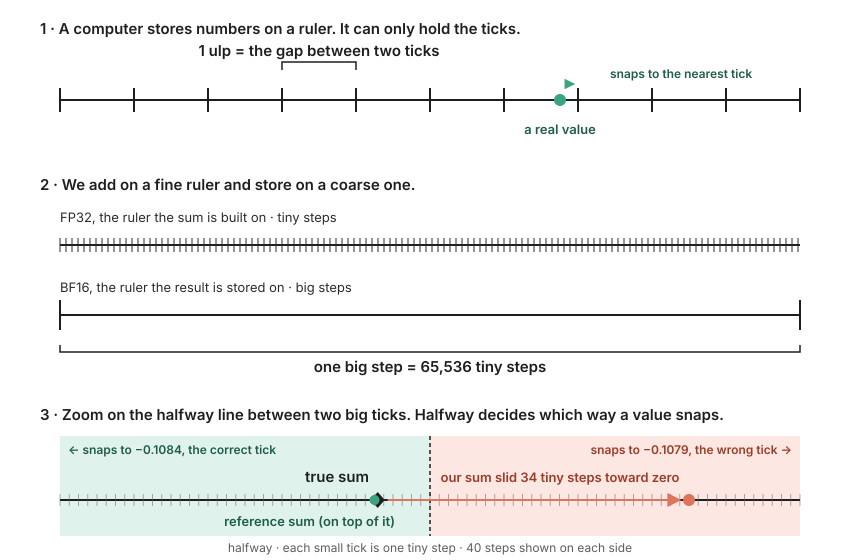
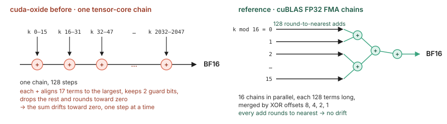
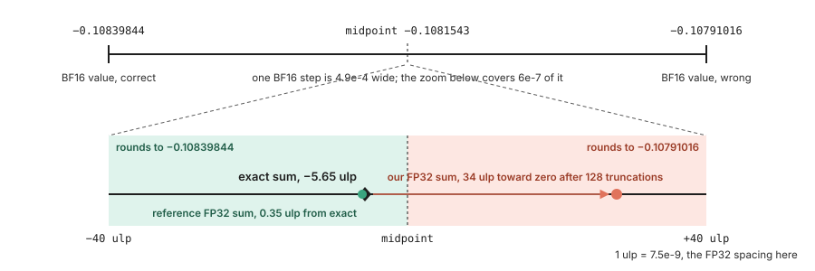
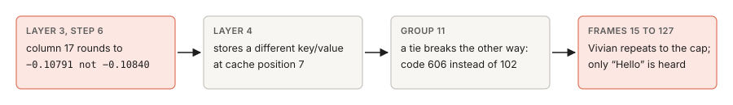
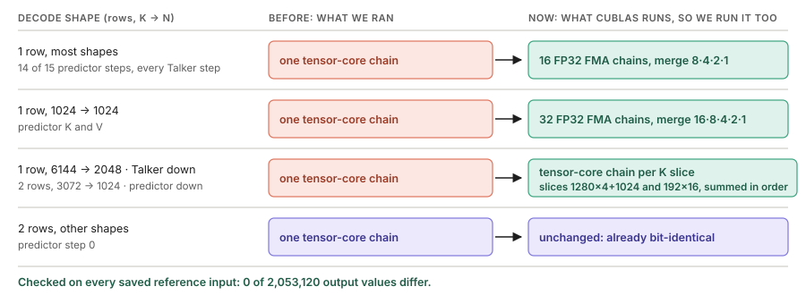

# Vivian repeated because our dot products rounded toward zero

Found and fixed 2026-10-17 on RTX 5090 (sm_120). Reference: torch 2.14.1+cu130, cuBLAS 13.0.
Machine-readable evidence: [results](decode-projection-rounding-results-20261017.json).

> Same 2,048 BF16 products, two different adders. Ours rounded toward zero at every step. The reference rounds to nearest. We now add exactly the way the reference does, shape by shape.

| | Before | After |
| --- | --- | --- |
| Decode projection bits versus the reference, same inputs | 1,274 of 1,966,080 differ | 0 of 2,053,120 differ |
| Vivian acceptance sentence, greedy | cap 127, only “Hello” | EOS 59, 4.72 s, full sentence (WER 0.125) |
| Ryan robot sentence, greedy | EOS 59, exact | EOS 55, 4.40 s, exact |
| Ryan acceptance sentence, greedy | EOS 49 | cap 127, like the official reference |
| Synthesis per codec frame | 11.6 ms | 11.0 ms |

## 0 · What an ulp is



**ulp**: the gap between two neighbouring numbers a format can hold. Every result snaps to the nearest one. We build each sum on the fine FP32 ruler (1 ulp = 7.5e-9 near 0.1) and store it on the coarse BF16 ruler (1 ulp = 4.9e-4). One BF16 step holds 65,536 FP32 steps, and the halfway line between two BF16 ticks decides which way a sum snaps.

## 1 · The two adders



Each output of a projection is one dot product: the input row times one stored weight row, 2,048 products, then a sum. The products are exact (BF16 × BF16 fits in FP32), so the whole difference is in the sum.

We ran one `mma.sync` tensor-core chain. Measured on this GPU with single instructions, each step aligns the 16 products and the accumulator to the largest exponent, keeps two guard bits, drops the rest and rounds toward zero. 128 such steps always nudge the sum the same way. The ten raw accumulators the earlier probe saved all sit toward zero, by 4 to 71 FP32 ulp.

The reference's one-row `F.linear` is cuBLAS `gemvx`: 16 FP32 FMA chains over `k mod 16`, every add round to nearest, merged by XOR offsets 8, 4, 2, 1. No bias, shorter chains.

## 2 · The value that flipped



The exact sum sits 5.65 FP32 ulp below the BF16 midpoint. The reference lands 0.35 ulp from exact and rounds correctly. Ours drifted 34 ulp toward zero, crossed the midpoint and rounded to the other BF16 value.



## 3 · The fix



cuBLAS picks its kernel, and so its summation order, from the row count and the weight shape. We read each kernel's order off the GPU with cancellation probes (a large value at `i`, its negative at `j`, a 1.0 at `m`: the 1.0 survives only if `i` and `j` meet before `m` joins), then confirmed the order against saved reference activations: a CPU emulation matched 1,784,832 values bit for bit.

The plan table lives in `src/reference_linear.rs`; the kernels in `src/reference_linear_kernel.rs`.

| Decode shape | cuBLAS kernel | Order | Our kernel now |
| --- | --- | --- | --- |
| 1 row, 1024→2048, 1024→3072, 2048→1024, 2048→2048, 2048→3072, 2048→6144, 3072→1024 | `gemvx<…,6,…>` | 16 FMA chains over k mod 16, merge 8·4·2·1 | `fma16_linear_bf16` (+bias) |
| 1 row, 1024→1024 | `gemvx<…,7,…>` | 32 chains, merge 16·8·4·2·1 | `fma32_linear_bf16` (+bias) |
| 1 row, 6144→2048 | `wmma 16x16_128x1` + `splitKreduce` | tensor-core chain per slice 1280, 1280, 1280, 1280, 1024; FP32 slice sums in order | `split_k_linear_bf16` |
| 2 rows, 3072→1024 | `wmma 16x16_128x2` + `splitKreduce` | sixteen 192-element slices, summed in order | `split_k_linear_bf16` |
| 2 rows, other shapes | `wmma 16x16_128x2` | one tensor-core chain | unchanged, already bit-identical |

Bias is added in FP32 before the single BF16 rounding on both sides. Shapes outside the table keep the tensor-core chain. Prefill (rows above 2) is unchanged.

You cannot make a tensor core round to nearest, so for the one-row shapes the fix leaves the tensor cores: with one input row, 15 of the 16 MMA rows were padding anyway, and the FMA kernels run at 0.65 to 0.76 of the old kernel's time.

## 4 · Checks

| Check | Result |
| --- | --- |
| Replay of every saved reference input through the production path (`--projection-worker`): predictor q/k/v/o/gate/up/down one and two rows, adapter, Talker q/k/v/o/gate/up/down and codec head | 0 of 2,053,120 values differ |
| `--decode-linear` exact gates: FMA kernels against a host emulation of the probed order, split K one-slice identity with the old kernel | 55,583 exact bits, 21,585 accuracy values |
| `--predictor-graph`, `--talker-decode` | pass |
| `cargo test`, `cargo fmt --check`, `cargo clippy -D warnings`, `cargo doc` | pass |

## 5 · Speed

Warm medians, three warmups and twenty runs, GPU otherwise idle, identical outputs in every batch. Reference rows are the 2026-10-17 optimized reference (hybrid/math) measurements from [the benchmark guide](../benchmark.md).

| Request | cuda-oxide before | cuda-oxide now | Optimized reference |
| --- | ---: | ---: | ---: |
| Vivian | cap 127: 1.625 s for 10.16 s of repetition | **0.648 s** for 4.72 s, 0.137 s per audio second | 0.569 s for 3.92 s, 0.145 |
| Ryan robot | 0.673 s for 4.72 s, 0.143 | **0.608 s** for 4.40 s, 0.138 | hybrid completes in 51 frames; no timing recorded |
| Ryan acceptance | 0.569 s for 3.92 s, 0.145 | cap 127: 1.576 s for 10.16 s | 0.547 s for 3.76 s, 0.146 |

Per kernel (`--decode-linear-bench`, median µs per launch):

| Rows | K → N | Old decode kernel | Reference order | Ratio |
| ---: | --- | ---: | ---: | ---: |
| 1 | 1024 → 1024 | 4.02 | 2.59 | 0.65 |
| 1 | 1024 → 2048 | 4.76 | 3.16 | 0.66 |
| 1 | 1024 → 3072 | 5.24 | 3.42 | 0.65 |
| 1 | 2048 → 1024 | 6.02 | 4.39 | 0.73 |
| 1 | 2048 → 2048 | 7.08 | 5.04 | 0.71 |
| 1 | 2048 → 3072 | 7.82 | 5.48 | 0.70 |
| 1 | 2048 → 6144 | 11.40 | 7.55 | 0.66 |
| 1 | 3072 → 1024 | 8.04 | 6.14 | 0.76 |
| 1 | 6144 → 2048, split K | 16.22 | 16.41 | 1.01 |
| 2 | 3072 → 1024, split K | 8.35 | 11.98 | 1.44 |

## 6 · What this does and does not settle

- Greedy Ryan now caps, exactly as the official reference does (`sdpa` math and auto both cap at 127). Only the optimized hybrid/faster variants finish Ryan, and they run different kernels again.
- All implementations already disagree inside frame 1 (first differing group 1, 4, 11 or 14 depending on the pair). Greedy pass/fail on these sentences is decided by rounding noise in both directions, so further accuracy changes are not a path to passing all three.
- Still different from the reference: the attention backend (FlashAttention or math SDPA rounding) and the prefill GEMMs for rows above 2, where cuBLAS uses split K that depends on the prompt length.

## 7 · Reproduce

```bash
cd cuda-oxide
CUDA_OXIDE_DEVICE_BACKEND=cutlass-mlir cargo oxide build qwen_decoder_cute --arch sm_120a
B=cute-rs-preview/models/qwen_decoder_cute/target/release/qwen_decoder_cute
$B --decode-linear
$B --projection-worker /tmp/qwen3-tts-acceptance/model     # JSON lines: {id, layer, stage, rows, input_bf16}
QWEN_TALKER_MODE=eager QWEN_PREDICTOR_MODE=graph $B --generate /tmp/qwen3-tts-acceptance/model \
  /tmp/qwen3-tts-acceptance/request-vivian-full.json /tmp/vivian.wav
```

Local probes, replay driver, WAVs, ASR reports and benchmark reports: `/tmp/qwen-reference-order-evidence/`.
