# Qwen3-TTS, end to end

> It speaks exactly the words you give it, no new words. What it “generates” is the sound: how those words are said in that voice (timing, pitch, pauses, accent), invented one 80 ms frame at a time, because the text alone doesn’t specify any of that.

The **codec** turns sound into integers and back: every 80 ms of speech is sixteen codes, the first a rough sketch of that slice and the other fifteen its finer detail. The **Talker**, the big transformer, reads the text and everything spoken so far and picks each frame's first code, the one choice that needs the whole context. The small **Predictor** fills in the other fifteen, so the expensive model runs once per frame and the cheap one fifteen times, and the finished frame feeds back into the Talker as its next input.

Model: `Qwen3-TTS-12Hz-1.7B-CustomVoice`. Example prompt throughout: *“Time for bed, little one”* plus two special pieces (voice, language) = 8 rows.

## 0 · The whole loop

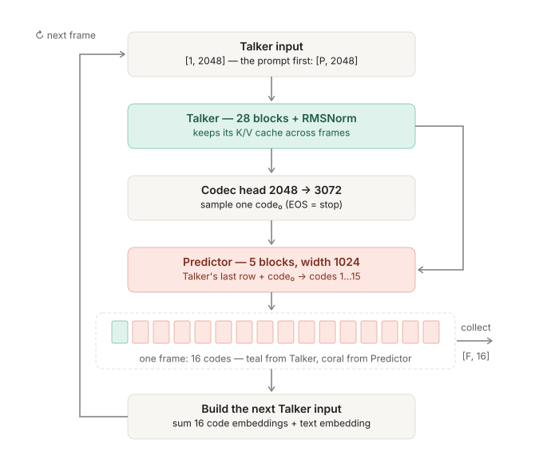

## 1 · Text → the Talker's input

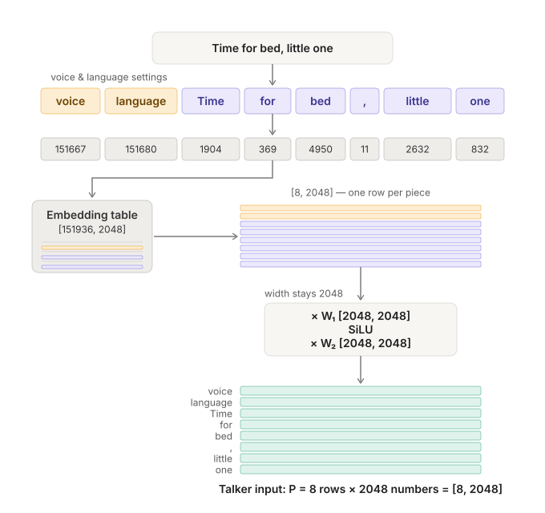

**piece**: a chunk of the text, with an integer ID in a 151,936-entry dictionary. **row**: one position as 2048 numbers. **projection**: multiply a row by a learned weight matrix (+ bias); the shape of W decides whether the width stays, shrinks or grows. Here it stays.

## 1b · Inside the projection: one row

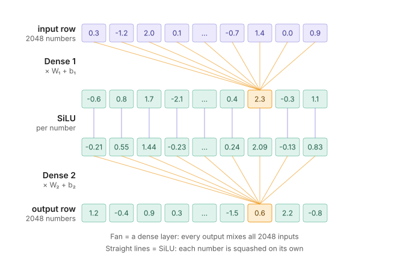

## 2 · The Talker from the outside

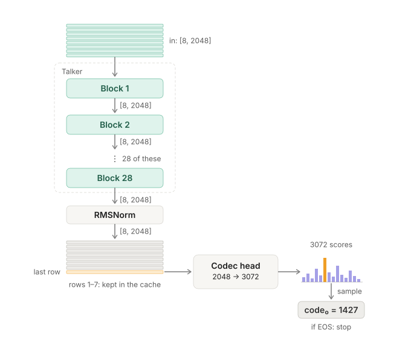

**prefill**: the whole prompt goes in at once (8 rows). Only the last row is read out; the other rows live on inside the cache.

## 3 · One of the 28 blocks

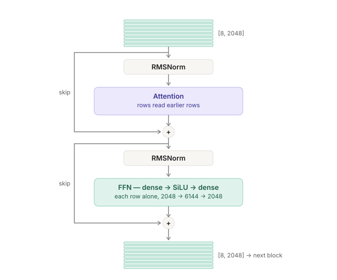

**skip**: the raw input (taken before the RMSNorm) is added back, element by element, to the half's output. Shapes in and out are identical, so the block stacks.

## 4 · Attention: who reads whom

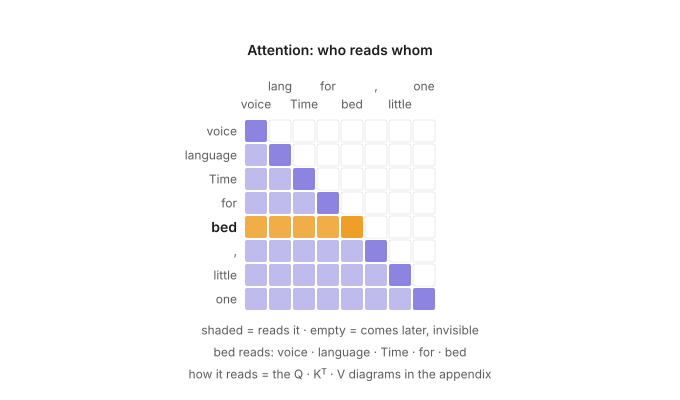

## 5 · The codec head: what a code is

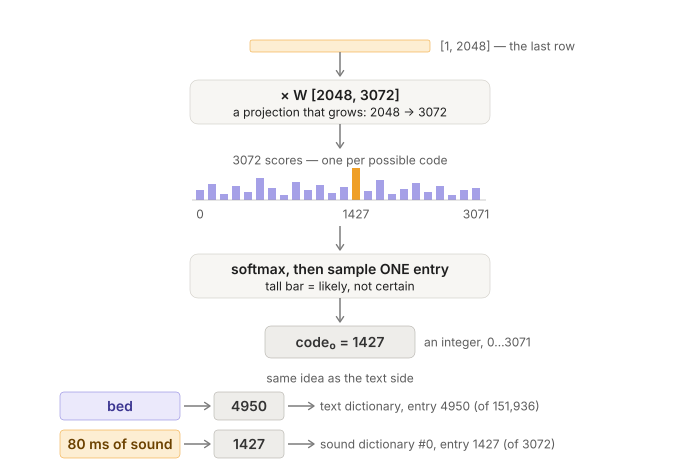

**code**: an integer pointing at one entry of a sound dictionary, the way a token ID points at a word piece. **codec**: the audio coder/decoder those dictionaries belong to. **EOS**: the entry that means "done". **head**: the last step that turns one row into scores (one per dictionary entry) and picks one integer: the codec head (2048 → 3072) and the fifteen Predictor heads (1024 → 2048). Not the same word as an *attention head*, which is a 128-wide slice of a Q, K or V row (see appendix).

## 6 · The Predictor: fifteen trips → sixteen codes

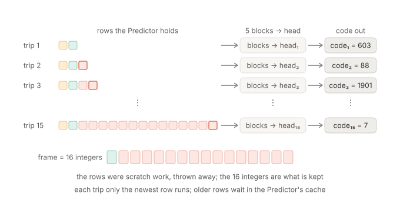

**frame**: 80 ms of audio = sixteen integers from sixteen different sound dictionaries = the output of one trip through Talker + Predictor.

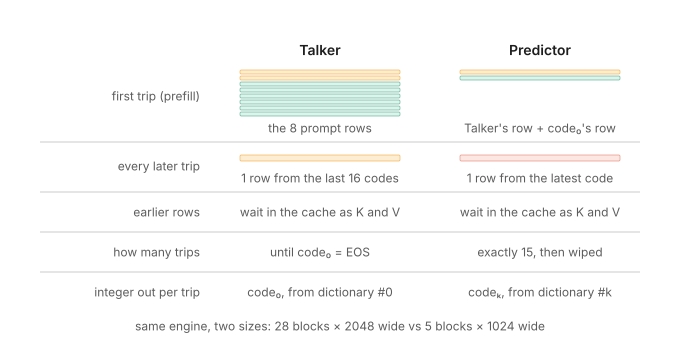

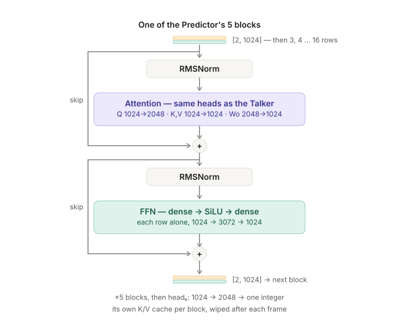

Same block design as the Talker's; only the widths differ. Rows are 1024 wide, so Q grows 1024 → 2048, K and V stay 1024, Wo shrinks 2048 → 1024, and the FFN goes 1024 → 3072 → 1024. Each of the five blocks keeps its own cache, wiped after every frame.

## 7 · A finished frame: filed away, and melted into the next row

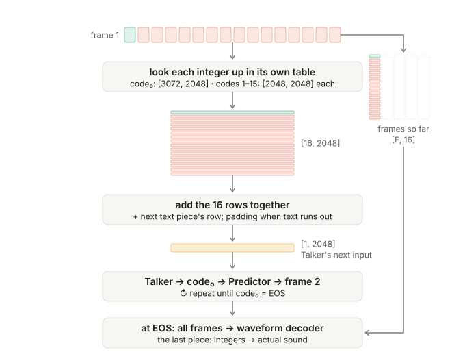

**step**: every trip after prefill takes one row in. The Talker hears its own last frame through that row.

## 8 · Frame two inside a block: the cache

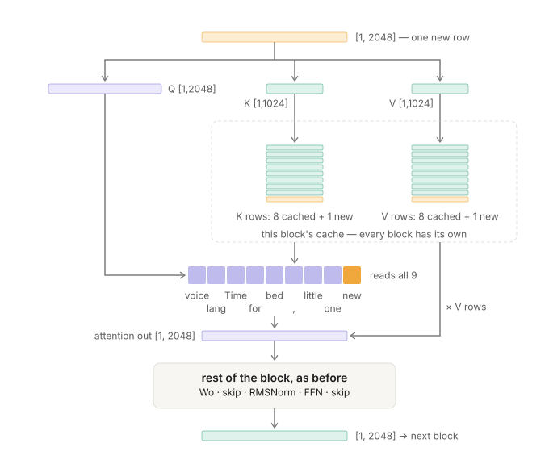

**cache**: the K and V rows an attention block keeps from earlier trips, so old rows are never recomputed. Talker caches live for the whole utterance; Predictor caches for one frame.

## 9 · Codes → sound

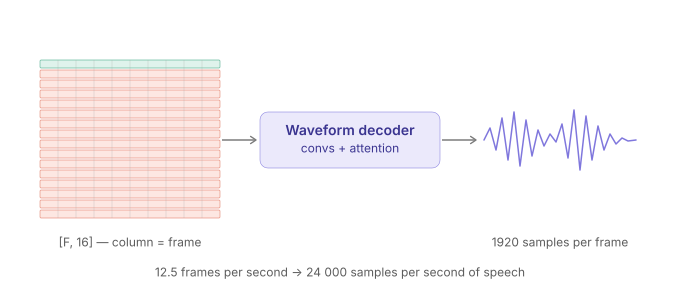

1920 samples per frame at 24 kHz = 80 ms, so 12.5 frames per second (the "12Hz" in the model name is a rounding).

## Appendix · Inside attention: Q, K, V and heads

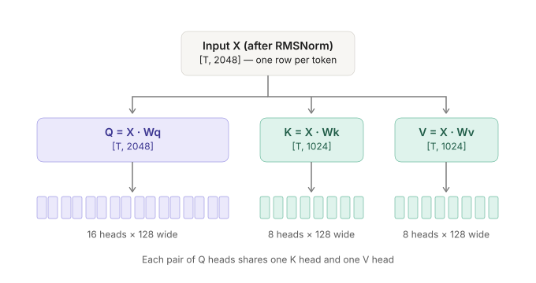

T = rows coming in now, S = rows visible in the cache. Each row makes its own Q, K, V; splitting into heads moves no data.

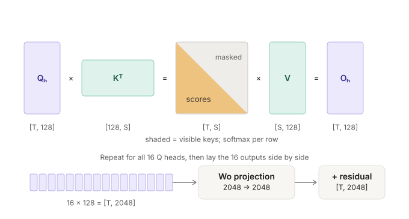
