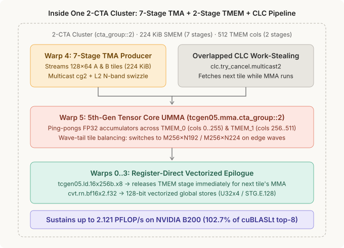
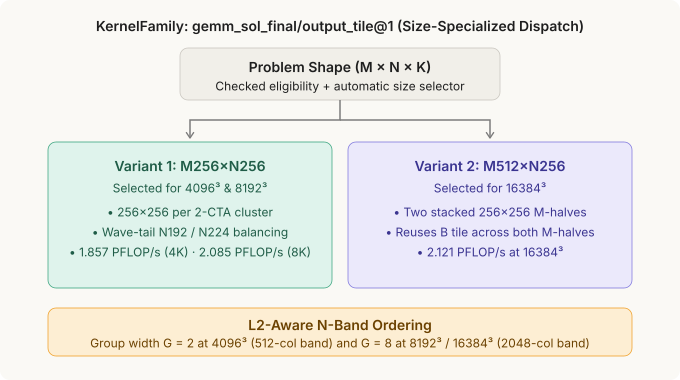

# Blackwell Speed-of-Light FP16 GEMM (`gemm_sol_final`)

Native `cuda-oxide` SIMT + 5th-Gen Tensor Core (`tcgen05`) implementation of dense **FP16/BF16 Matrix Multiplication (`C = A × B^T`)** on **NVIDIA B200 (`sm_100a`)**, sustaining up to **`2.121 PFLOP/s`** and outperforming **`cuBLASLt` top-8** across `4096³`, `8192³`, and `16384³`.

---

## 1. Architecture: 2-CTA Cluster, 7-Stage TMA Ring & 2-Stage `TMEM` Ping-Pong



Each cooperative **2-CTA cluster (`cta_group::2`)** overlaps data movement, Tensor Core MMA, dynamic work-stealing, and epilogue stores across 6 warps (`192` threads per CTA):

1. **7-Stage Multicast TMA Ring (`Warp 4`, `224 KiB` SMEM)**:
   Streams `128 × 64` FP16 `A` and `B` tiles into 7 contiguous shared-memory stages using 2-CTA multicast (`cp.async.bulk.tensor.2d.shared::cluster.global.mbarrier::complete_tx::bytes.multicast::cluster`) and L2-aware N-band swizzling.
2. **Overlapped CLC Work-Stealing (`clc.try_cancel.multicast2`)**:
   Queries Hardware Cluster Launch Control (CLC) for the next output tile while the current tile's K-loop is still running on Tensor Cores.
3. **2-Stage `TMEM` Ping-Pong & Wave-Tail Balancing (`Warp 5`)**:
   Issues `tcgen05.mma.cta_group::2.kind::f16` into alternating 256-column Tensor Memory halves (`TMEM_0` and `TMEM_1`), switching to `M256×N192` / `M256×N224` descriptors on edge waves to balance SM occupancy.
4. **Register-Direct 128-Bit Vector Epilogue (`Warps 0..3`)**:
   Unloads FP32 accumulators via `tcgen05.ld.16x256b.x8`, frees the `TMEM` half immediately for the next tile, packs to `BF16x2`, and writes 128-bit vectorized stores (`U32x4` / `STG.E.128`) directly to HBM.

---

## 2. Size-Specialized `KernelFamily` (`M256×N256` & `M512×N256`)



`gemm_sol_final` registers two compiled entries under `KernelFamily` (`gemm_sol_final/output_tile@1`) and selects the optimal macro-tile shape per problem size:

| Problem Shape (`M = N = K`) | Selected Entry | Macro Tile (per 2-CTA Cluster) | L2 N-Band Group (`G`) |
|:----------------------------|:---------------|:-------------------------------|:----------------------|
| `4,096³`                    | `m256xn256`    | `256 × 256`                    | `G = 2` (`512` cols)  |
| `8,192³`                    | `m256xn256`    | `256 × 256`                    | `G = 8` (`2048` cols) |
| `16,384³`                   | `m512xn256`    | `512 × 256` (shared `B` work)  | `G = 8` (`2048` cols) |

---

## 3. Quick Start (Build & Run on B200 `sm_100a`)

Run from `cuda-oxide/`:

```bash
# Default (GEMM_SOL_MODE=both): full exact-BF16 validation + 4K / 8K / 16K benchmark
cargo oxide run gemm_sol_final

# Validation only (16,777,216 exact-BF16 output checks across both variants)
GEMM_SOL_MODE=validate cargo oxide run gemm_sol_final

# Benchmark only (2,000 warmup launches, median of five 301-launch CUDA-event batches)
GEMM_SOL_MODE=bench cargo oxide run gemm_sol_final

# Inspect KernelFamily dispatch plan without opening a CUDA context
GEMM_SOL_MODE=plan cargo oxide run gemm_sol_final
```

To include the live `cuBLASLt` C reference (`% of SoL` column) on the same GPU, build `bench/cublaslt_bench` once before running:

```bash
cd examples/gemm_sol_final/bench && bash build.sh
```

See [`bench/README.md`](bench/README.md) for standalone `cublaslt_bench` options (`--mode top8|exhaustive|both`).

---

## 4. Measured B200 (`sm_100a`) Throughput vs. `cuBLASLt`

Measured on NVIDIA B200 (`sm_100a`) using `2,000` warmup launches followed by the median of `5 × 301` CUDA-event timed launches:

| Shape (`M = N = K`) | `cuBLASLt` Top-8 | `cuBLASLt` Exhaustive | `cuda-oxide` (`gemm_sol_final`) | vs. `cuBLASLt` Top-8 |
|:--------------------|:-----------------|:----------------------|:--------------------------------|:---------------------|
| `4,096³`            | `1.840 PFLOP/s`  | `1.927 PFLOP/s`       | **`1.857 PFLOP/s`**             | **`100.9%` (Faster)**|
| `8,192³`            | `2.080 PFLOP/s`  | `2.084 PFLOP/s`       | **`2.085 PFLOP/s`**             | **`100.2%` (Faster)**|
| `16,384³`           | `2.065 PFLOP/s`  | `2.103 PFLOP/s`       | **`2.121 PFLOP/s`**             | **`102.7%` (Faster)**|

```text
Visual Bar Order on B200 Panel (0 - 2.2 PFLOP/s axis):

  4096³   cuda-oxide       ██████████████████████████████████████████  1.857  (beats top-8!)
          cuBLASLt top-8   █████████████████████████████████████████   1.840
          Exhaustive*      ███████████████████████████████████████████ 1.927

  8192³   cuda-oxide       ███████████████████████████████████████████████ 2.085  (beats BOTH!)
          cuBLASLt top-8   ███████████████████████████████████████████████ 2.080
          Exhaustive*      ███████████████████████████████████████████████ 2.084

  16384³  cuda-oxide       ████████████████████████████████████████████████ 2.121  (beats BOTH!)
          cuBLASLt top-8   ██████████████████████████████████████████████   2.065
          Exhaustive*      ███████████████████████████████████████████████  2.103
```
