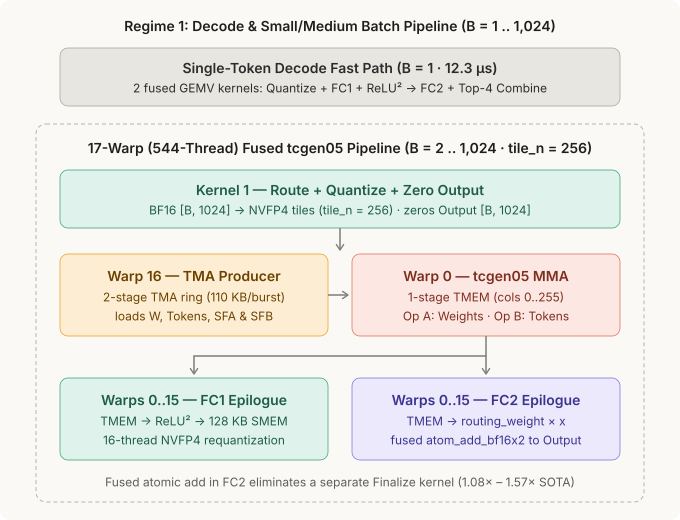
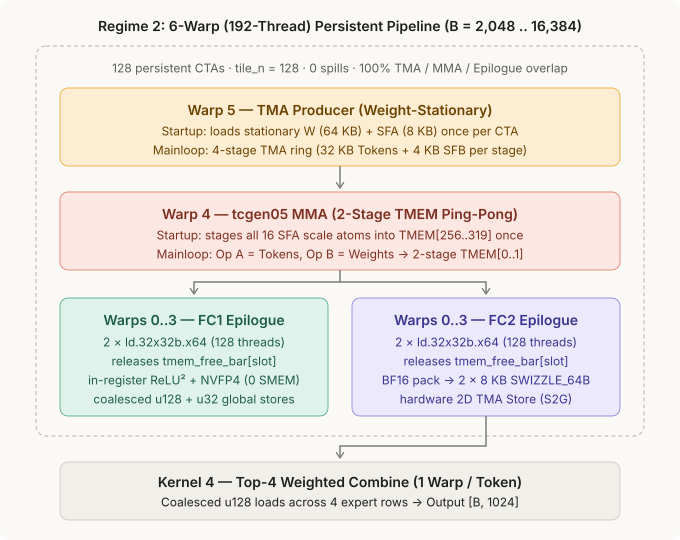

# Nemotron-3 NVFP4 ReLU² Mixture-of-Experts (`nemotron3_moe`)

Native `cuda-oxide` SIMT + 5th-Gen Tensor Core (`tcgen05`) implementation of **one complete Mixture-of-Experts (MoE) layer** from **NVIDIA Nemotron-3** on Blackwell (`sm_100a`), using hardware block-scaled **NVFP4** (`Float4E2M1FN` values + `Float8E4M3FN` scales, `1` scale per `16` values) and non-gated **`ReLU²(x) = max(0, x)²`** activation.

See [`visual.md`](visual.md) for the step-by-step visual walkthrough and SVG diagrams.

---

## 1. What We Measure (One Full MoE Layer in a Captured CUDA Graph)

| Parameter | Value | Description |
| :--- | :--- | :--- |
| **Hidden size (`H`)** | `1,024` | Input and output token embedding dimension (`BFloat16`) |
| **Intermediate size (`I`)** | `1,024` | Per-expert FFN width (`FC1: 1024 -> 1024`, `FC2: 1024 -> 1024`) |
| **Experts (`E`) / Top-K (`K`)** | `8` / `4` | Each token routes to `4` of `8` experts (`4 × B` routed token-expert pairs) |
| **Precision** | `NVFP4` | `Float4E2M1FN` weights/activations + `Float8E4M3FN` block scales (`SF_VEC = 16`) |
| **Batch sizes (`B`)** | `1 .. 16,384` | All 15 power-of-two token batch sizes verified against a CPU oracle |

Every implementation captures the **exact same end-to-end MoE layer** (`BF16 Input -> Quantize -> Route -> FC1 + ReLU² + Requantize -> FC2 + Top-4 Combine -> BF16 Output`) inside a single CUDA Graph and measures mean latency over **`1,000` graph replays**:

```text
BeginCapture                                                                 EndCapture
┌─────────────────────────────────────────────────────────────────────────────────────┐
│  [K1: Quantize BF16->FP4] ──► [K2: Route] ──► [K3: FC1+ReLU²] ──► [K4: FC2+Combine] │
└─────────────────────────────────────────────────────────────────────────────────────┘
Start CUDA Event ──► Replay Captured Graph 1,000× ──► Stop CUDA Event (mean = total / 1000)
```

---

## 2. Architecture Across Both Batch Regimes

### Regime 1: Decode & Small/Medium Batch (`B = 1 .. 1,024` · `tile_n = 256`, Fused `atom_add_bf16x2`)



* **`B = 1` (Single-Token Decode):** Runs 2 fused SIMT GEMV kernels (`fc1_relu2_requant_direct` and `fc2_and_finalize_direct`) using `dp4a` and warp shuffle reductions without Tensor Core launch overhead (`12.28 µs` vs. `18.43 µs` SOTA).
* **`B = 2 .. 1,024` (`17`-Warp / `544`-Thread `tcgen05` Pipeline):** `Warp 16` streams `256`-token groups (`tile_n = 256`), `Warp 0` issues `tcgen05.mma` with adaptive `valid_n` (`16 .. 256`), and `Warps 0..15` (`512` threads) fuse `routing_weight × x` and `atom_add_bf16x2` directly inside `FC2` to eliminate a separate `Finalize` launch (`1.17x – 1.57x` faster than SOTA).

---

### Regime 2: Large Batch / Prefill (`B = 2,048 .. 16,384` · `tile_n = 128`, 6-Warp Persistent Pipeline)



At `B = 2,048 .. 16,384`, `FC1` (`tcgen05_grouped_fc1_relu2_requant_128`) and `FC2` (`tcgen05_grouped_fc2_128`) launch `128` persistent CTAs with **`6` warps (`192` threads)** per CTA (`0` stack spills), keeping expert weights stationary in `SMEM_A` + `TMEM[256..319]`, streaming `128`-token groups through a **4-stage TMA ring**, ping-ponging across **2-stage `TMEM` (`cols 0..127` / `cols 128..255`)**, and overlapping Tensor Core MMA with the epilogue 100%.

---

## 3. Quick Start (Build & Run)

Run the **Native `cuda-oxide` SIMT** model (from anywhere in the repository):

```bash
cargo oxide run nemotron3_moe --arch sm_100a
```

Run the **`cute-rs` (`cutlass-mlir`)** counterpart:

```bash
CUDA_OXIDE_DEVICE_BACKEND=cutlass-mlir cargo oxide run nemotron3_moe_cute --arch sm_100a
```

---

## 4. Source Layout

* [`src/kernels.rs`](src/kernels.rs) — Standard 8-expert GPU kernels (`fused_route_and_quantize_tcgen05`, `tcgen05_grouped_fc1_relu2_requant`, `tcgen05_grouped_fc1_relu2_requant_128`, `tcgen05_grouped_fc2`, `tcgen05_grouped_fc2_128`, `moe_finalize_tcgen05`, and small-batch `dp4a` kernels).
* [`src/moe_192e.rs`](src/moe_192e.rs) — Wide 192-expert (`H = 6144, I = 1536, E = 192, top_k = 4, B = 1 .. 256`) single/dual/triple-M `tcgen05` kernels, dynamic route bucketizer, and non-uniform / post-capture route-change validation.
* [`src/main.rs`](src/main.rs) — Deterministic synthetic data generator, CPU reference oracle, 2D TMA descriptor setup (`cuTensorMapEncodeTiled`), CUDA Graph capture/replay harness, and benchmark table printer.
* [`reference/`](reference/) — Standalone FlashInfer CuTeDSL (`flashinfer.fused_moe.cute_dsl_fused_moe`, `w4a4` + `Relu2`) reproduction script ([`reference/benchmark_flashinfer.py`](reference/benchmark_flashinfer.py)) and instructions ([`reference/README.md`](reference/README.md)).
* [`visual.md`](visual.md) — Visual architecture guide with SVG diagrams under [`svg/`](svg/).

---

## 5. Measured B200 (`sm_100a`) CUDA Graph Latency (`B = 1 .. 16,384`, `max_error = 0.000000`)

```text
Batch size | FlashInfer CuTeDSL (us) | Native SIMT [live] (us) |     cute-rs [ref] (us) | Native vs. SOTA
-----------+-------------------------+-------------------------+------------------------+----------------
         1 |                  18.430 |                  12.283 |                 12.296 |      1.50x SOTA
         2 |                  18.420 |                  14.329 |                 14.344 |      1.29x SOTA
         4 |                  18.420 |                  14.345 |                 14.332 |      1.28x SOTA
         8 |                  18.440 |                  14.345 |                 14.344 |      1.29x SOTA
        16 |                  20.390 |                  14.331 |                 14.338 |      1.42x SOTA
        32 |                  19.800 |                  14.343 |                 14.345 |      1.38x SOTA
        64 |                  20.490 |                  14.345 |                 14.344 |      1.43x SOTA
       128 |                  22.520 |                  14.345 |                 14.345 |      1.57x SOTA
       256 |                  23.240 |                  16.377 |                 16.377 |      1.42x SOTA
       512 |                  24.570 |                  18.443 |                 19.222 |      1.33x SOTA
      1024 |                  28.750 |                  24.589 |                 26.611 |      1.17x SOTA
      2048 |                  38.890 |                  32.266 |                 32.796 |      1.21x SOTA
      4096 |                  51.250 |                  49.144 |                 51.192 |      1.04x SOTA
      8192 |                  92.610 |                  88.291 |                 90.351 |      1.05x SOTA
     16384 |                 179.350 |                 174.835 |                173.943 |      1.03x SOTA
```

---

## 6. Wide 192-Expert Workload (`H = 6144, I = 1536, E = 192, top_k = 4`, `B = 1 .. 256`)

```text
Batch | TRTLLM-Gen (us) | FlashInfer CuTeDSL (us) | cuTile NVFP4 (us) | Native SIMT [live] (us) | cute-rs [ref] (us) | vs. TRTLLM-Gen
------+-----------------+-------------------------+-------------------+-------------------------+--------------------+---------------
    1 |          24.570 |                  24.591 |            22.547 |                  22.506 |             22.519 |      1.09x
    2 |          24.570 |                  24.685 |            22.541 |                  22.518 |             22.539 |      1.09x
    4 |          24.583 |                  24.991 |            22.541 |                  22.517 |             22.530 |      1.09x
    8 |          24.569 |                  26.636 |            24.590 |                  22.518 |             22.541 |      1.09x
   16 |          24.704 |                  28.660 |            26.614 |                  23.551 |             24.564 |      1.05x
   32 |          28.689 |                  28.661 |            31.077 |                  26.611 |             28.667 |      1.08x
   64 |          31.209 |                  28.761 |            30.502 |                  30.467 |             32.752 |      1.02x
  128 |          38.436 |                  30.710 |            33.321 |                  36.845 |             40.611 |      1.04x
  256 |          51.196 |                  34.800 |            49.252 |                  45.062 |             49.138 |      1.14x
```
