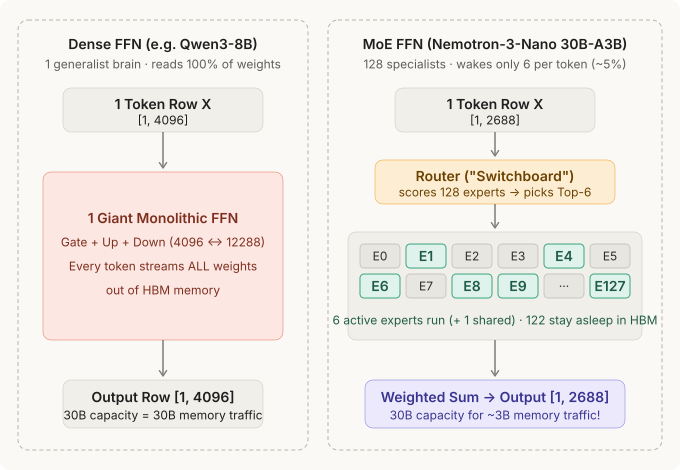
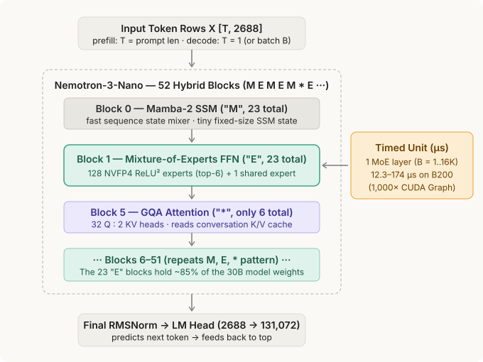
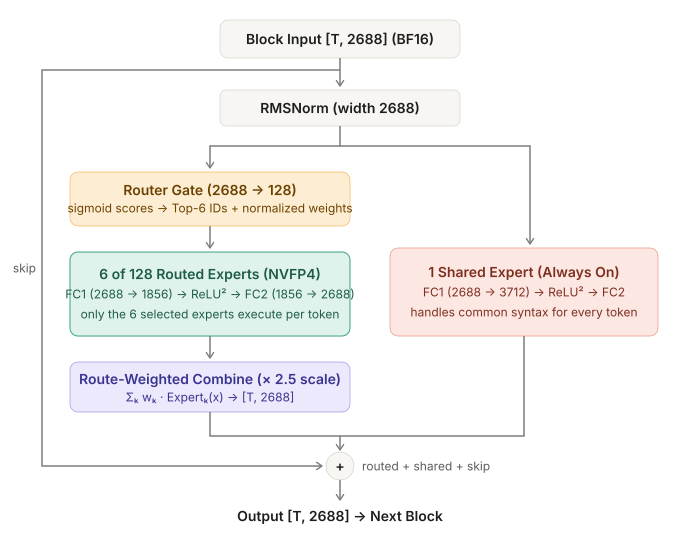
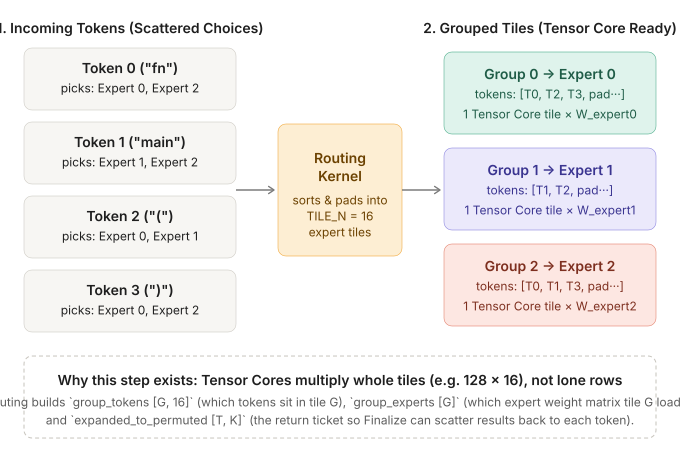
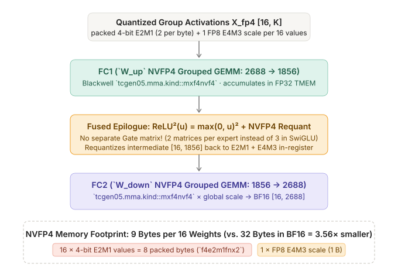
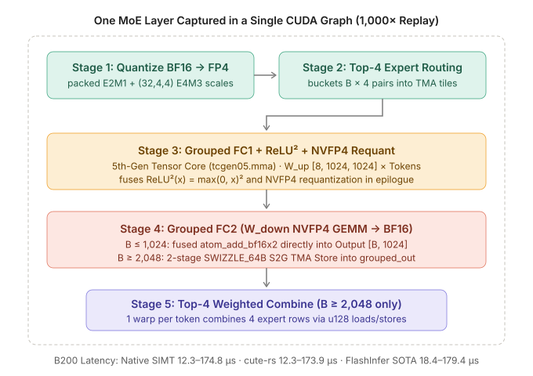
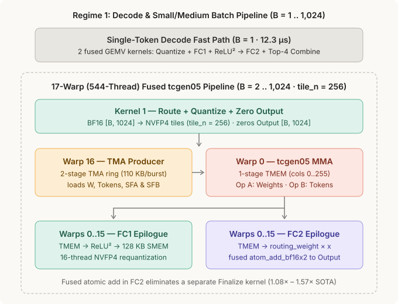
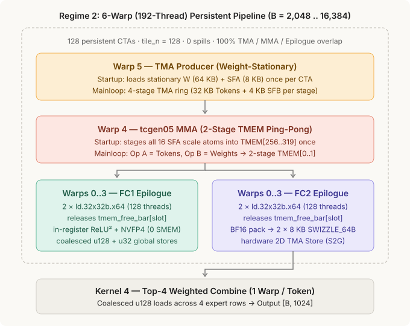

# Nemotron-3 Mixture-of-Experts (MoE), end to end

> A **Mixture-of-Experts (MoE)** layer replaces a Transformer block's single giant Feed-Forward Network (FFN) with a **Router ("switchboard")** and **many small specialist FFNs ("Experts")**. Every token stores knowledge across all **128 specialists** (`30B` total parameters in `NVIDIA-Nemotron-3-Nano-30B-A3B`), but only wakes up **6 specialists** (`~3B` active parameters) per token.

In `nemotron3_moe`, each MoE layer takes token rows `[T, H]` in **BF16**, routes each token to its **Top-K** specialists, quantizes activations into **Blackwell NVFP4 (`Float4E2M1FN` + `Float8E4M3FN` block scales)**, runs a non-gated **`FC1 → ReLU² → Requant → FC2`** pipeline across the active expert buckets, and blends the weighted expert outputs back into **BF16 `[T, H]`**.

Model family: `nvidia/NVIDIA-Nemotron-3-Nano-30B-A3B-NVFP4` (`H = 2688, I = 1856, E = 128, top_k = 6` + `1` shared expert) and the canonical benchmark fixture (`H = 1024, I = 1024, E = 8, top_k = 4`).

## 0 · Dense FFN vs. Mixture-of-Experts (Why MoE Exists)

In a **dense model** (`Qwen3-8B`), the second half of every block is **one monolithic FFN**. Generating a single token requires streaming **100% of those FFN weights** out of GPU HBM memory. In **Nemotron-3 MoE**, that monolithic FFN is split into **128 small specialist FFNs ("Experts")**. A tiny linear **Router** looks at the incoming token row and picks the **6 best specialists** for that token; the other **122 specialists stay asleep in HBM**, giving `30B` model capacity at `~3B` memory bandwidth cost.

## 1 · The 52-Layer Hybrid Stack & What the Microsecond (`µs`) Timer Measures

**Half 1 vs. Half 2 memory**: Sequence mixers (**Mamba-2 `"M"`** and **GQA Attention `"*"`**) maintain the *conversation state* (the SSM state and **K/V cache** that grow with the session). **MoE blocks (`"E"`, 23 of the 52 layers)** hold `~85%` of the *frozen model weights* (`W_up` and `W_down` loaded from the checkpoint) and only look at the **current token rows `[T, 2688]`**. When we benchmark an MoE kernel in **microseconds (`µs`)**, we are timing **one `"E"` block** across all 4 MoE stages (`12.28 .. 174.84 µs` in `Native SIMT` and `12.30 .. 173.94 µs` in `cute-rs` vs. `18.43 .. 179.35 µs` in `FlashInfer CuTeDSL` across `B = 1 .. 16,384`).

## 2 · Inside One MoE Block: Router + 128 Routed Experts + 1 Shared Expert

After `RMSNorm(2688)`, each token row splits into two parallel paths before the `+ skip` residual:
1. **Routed path (left)**: The **Router** multiplies `[T, 2688]` by a tiny `[2688, 128]` matrix, applies `sigmoid`, and selects the **Top-6 expert IDs** and their normalized weights. Only those 6 experts run (`2688 → 1856 → ReLU² → 2688`), and their outputs are blended by their routing weights (`× 2.5` scaling factor).
2. **Shared path (right)**: **1 Shared Expert** (`2688 → 3712 → ReLU² → 2688`) runs unconditionally on every token so the 128 routed experts don't have to waste capacity re-learning basic grammar and punctuation.

## 3 · Why Batched MoE Needs Routing & Token Bucketing (Stage 1)

When a batch of tokens arrives (`T = 4`, `16`, or `256`), each token picks a **different combination of experts**. Tensor Cores cannot efficiently multiply scattered rows one by one—they operate on contiguous matrix tiles (such as `TILE_M × TILE_N = 128 × 16`). The **Routing Kernel** groups all tokens that chose the same expert into contiguous **`TILE_N = 16` buckets** (`group_tokens [G, 16]` and `group_experts [G]`) and records a return-ticket table (`expanded_to_permuted [T, top_k]`) so the final stage knows where each token's answer landed.

## 4 · Inside One Expert Bucket: Non-Gated `ReLU²` & Blackwell NVFP4 (Stages 2–4)

Unlike Llama/Qwen SwiGLU FFNs—which require **three** weight matrices per expert (`W_gate`, `W_up`, `W_down`)—Nemotron-3 uses **non-gated `ReLU²(u) = max(0, u)²`**, needing only **two** weight matrices per expert (`W_up` and `W_down`, **33% fewer weight bytes**):
- **NVFP4 (`Float4E2M1FN` + `Float8E4M3FN`)**: Every 16 values along `K` are packed into **8 bytes** of 4-bit `E2M1` nibbles plus **1 byte** of `E4M3` block scale (**9 bytes vs. 32 bytes in BF16**, a **3.56×** reduction).
- **Fused `FC1 → ReLU² → Requant`**: `FC1` multiplies the `[128, 512]` weight tile by the `[512, 16]` activation tile on Blackwell Tensor Cores (`tcgen05.mma.kind::mxf4nvf4`), applies `max(0, u)²` in the epilogue registers, and immediately requantizes the intermediate activations back into NVFP4 for `FC2`.

## 5 · The GPU Pipeline on NVIDIA B200 (`sm_100a`)

Both **Native `cuda-oxide` SIMT** and **`cute-rs` (`cutlass-mlir`)** beat **FlashInfer CuTeDSL (SOTA)** across all 15 batch sizes (`B = 1 .. 16,384`) on NVIDIA B200 (`sm_100a`) using two specialized architectures:

### Regime 1 (`B = 1 .. 1,024`): 17-Warp (`544`-Thread) Fused `atom_add_bf16x2` Pipeline

### Regime 2 (`B = 2,048 .. 16,384`): 6-Warp (`192`-Thread) Persistent Weight-Stationary Pipeline

